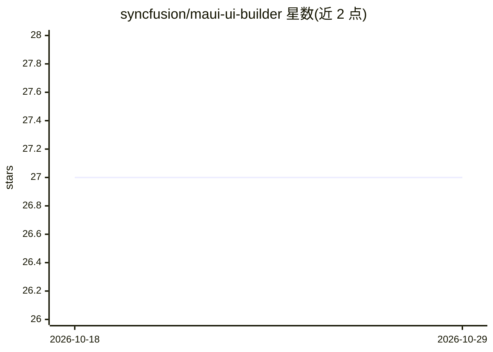

# syncfusion/maui-ui-builder

⭐ 27 · JavaScript · 推送 2026-06-01 · [GitHub](https://github.com/syncfusion/maui-ui-builder) · [官网](https://www.syncfusion.com/explore/agentic-ui-builder/) · 组织维护

**面向 .NET MAUI 的 AI agent 技能：按需求生成 UI 组件代码**

由 Syncfusion 维护的 AI agent 技能包，安装到 GitHub Copilot 等 AI 助手后，通过 8 阶段编排工作流（意图分析、项目检测、组件映射、主题设计、代码生成、验证、依赖安装、代码插入）将自然语言 UI 需求转换为生产可用的 .NET MAUI 组件，基于 Syncfusion MAUI 控件库，遵循 MVVM 模式与 WCAG 2.1 AA 无障碍标准，覆盖 iOS/Android/Windows/macOS。前置要求包括 APM 包管理器、.NET SDK 9.0+、MAUI 9.0+ 项目及 Syncfusion 许可证（含免费社区版）。

## 筛选速览

| 维度 | 判定 | 备注 |
|---|---|---|
| AI 角色 | `ai-ecosystem` | LLM/agent 周边工具 |
| 许可风险 | `none` | — |
| 部署形态 | `None` |  |
| 模型依赖 | — | README 未给出锁定关系 |
| 硬件要求 | — | 无带数字的原话,不猜 |
| 安装摩擦 | `medium` | 含编译或系统依赖之一 |
| 成熟度 | — | 结构信号不足 |

## 能力要点

- 8 阶段 AI 编排工作流从需求到代码插入
- 生成 XAML、code-behind 与 ViewModel（MVVM 模式）
- WCAG 2.1 AA 无障碍合规与多平台响应式布局
- 自动检测并安装 Syncfusion NuGet 依赖包

## 适用场景

- 让 AI 助手按自然语言描述生成 MAUI 跨平台 UI 组件
- 在现有 MAUI 项目中快速搭建带无障碍与响应式支持的界面
- 统一团队 UI 代码的设计系统与 Syncfusion 控件用法

## 场景标签

`代码生成` · 领域:编码与开发

## 证据(README 行号)

> L3: **Syncfusion MAUI UI Builder** is an AI-powered agent skill that transforms your UI requirements into production-rea
> L7: - **AI Agent Orchestration**: Intelligent workflow handling design thinking, component selection, code generation, a

## 星数曲线

2026-10-18 27 → 2026-10-29 27（+0）

---
*卡片 v1 · prompt 1.4 · 生成 2026-10-26 · 置信度 high · 依据 README sha `41f1a263834d` · [字段定义](../../DATASET.md)*
