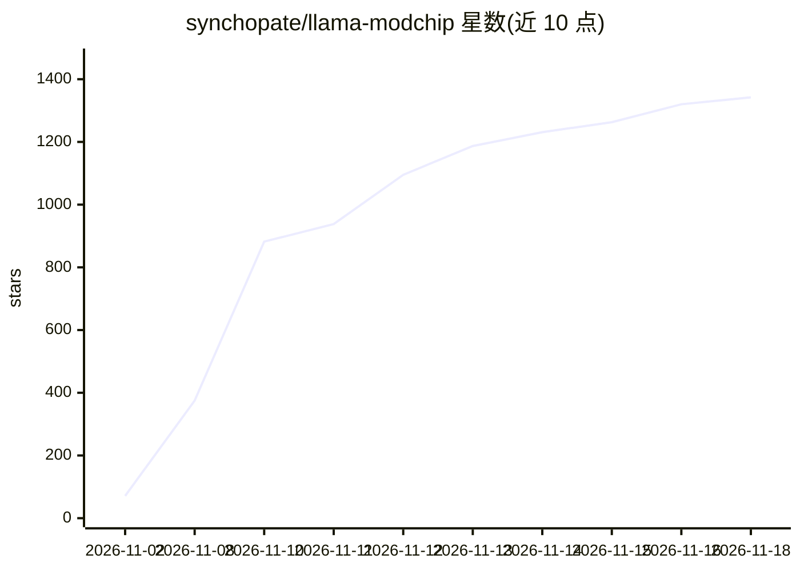

# synchopate/llama-modchip

⭐ 1,342 · Python · Apache-2.0 · 推送 2026-11-17 · [GitHub](https://github.com/synchopate/llama-modchip) · [官网](https://github.com/synchopate/llama-modchip#readme) · 组织维护

**面向 16/32/64GB 内存的 CPU 优先 llama.cpp 推理引擎与压缩模型分发**

基于 llama.cpp 的推理引擎（v3.0），配合自研 MaxQ 压缩 GGUF 检查点，在纯 CPU（0 GPU）上运行 Qwen3.8-Flash-Next、DeepSeek-V4 284B、Nemotron-3.5 30B 等模型。单一二进制自动检测 RAM 档位与 CPU ISA（AVX-512/AVX2/ARM64 NEON/Apple Metal），内置 NextN MTP 投解码、Stockfish-PVS 投射采样、SSE 网关（:8787）与后台 llama-server（:8789）。提供 ./modchip 命令行管理 setup/chat/web/bench/eval 等操作，支持 Linux/macOS/Windows，并提供 Claude Code CLI 对接命令。提供可选 abliterated（消拒）检查点，需显式确认安装。

## 筛选速览

| 维度 | 判定 | 备注 |
|---|---|---|
| AI 角色 | `ai-ecosystem` | LLM/agent 周边工具 |
| 许可风险 | `permissive` | Apache-2.0 |
| 部署形态 | `None` |  |
| 模型依赖 | local-ok | 支持本地模型 |
| 硬件要求 | — | 无带数字的原话,不猜 |
| 安装摩擦 | `medium` | 含编译或系统依赖之一 |
| 成熟度 | — | 结构信号不足 |

## 能力要点

- 单一 v3.0 二进制自动检测 RAM 档位（16/32/64GB）与 CPU ISA
- 内置 NextN MTP 投解码与 Stockfish-PVS v2 投射采样
- 0 GPU 要求，DeepSeek-V4 284B 在 64GB RAM 内运行（57.99 GiB 占用）
- MaxQ-32GB 通过 Cgroup v2 严格验证（≤28.5 GiB，mmap 需求分页 PLE 表）

## 适用场景

- 在 64GB 无独显的机器上本地运行 284B/大参数 MoE 模型
- 在 16/32GB 消费级电脑上跑 30B 级 MoE 模型
- 把 Claude Code CLI 接到本地推理引擎工作

## 场景标签

`推理引擎` `模型量化` · 领域:训练与推理

## 证据(README 行号)

> L3: ### Unified 16 GB · 32 GB · 64 GB MaxQ Inference Engine for `Qwen3.8-Flash-Next`, `DeepSeek-V4 284B` & `Nemotron-3.5
> L26: One unified `llama-modchip v3.0` binary (`GLIBC <= 2.30`, static `libstdc++` & `libgomp`, zero external OpenMP `.so
> L75: |**`./modchip setup`**|Auto-detects RAM tier (`16 / 32 / 64 GB`) & CPU ISA, installs `v3.0` engine + SHA-256 verifi

## 星数曲线

2026-11-02 71 → 2026-11-18 1,342（+1,271）

---
*卡片 v1 · prompt 1.4 · 生成 2026-11-17 · 置信度 high · 依据 README sha `ff0de4c223cc` · [字段定义](../../DATASET.md)*
