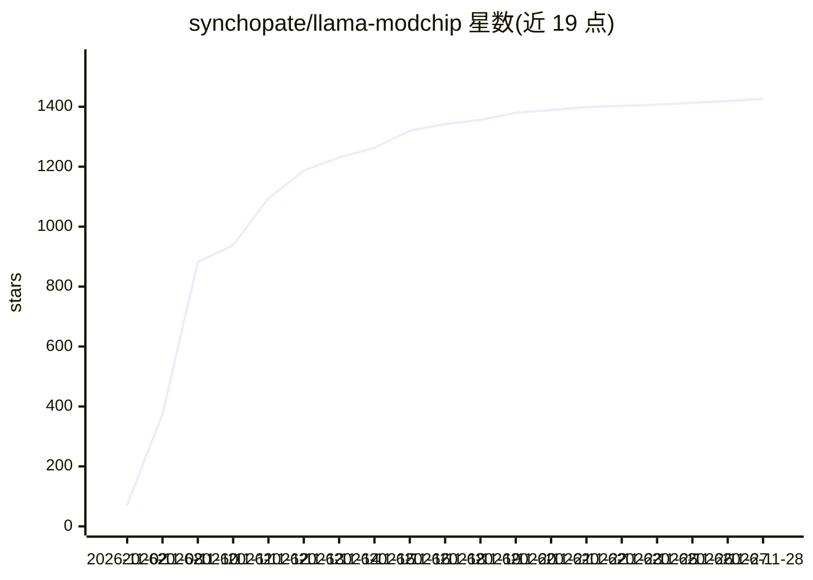

# synchopate/llama-modchip

⭐ 1,426 · Python · Apache-2.0 · 推送 2026-11-27 · [GitHub](https://github.com/synchopate/llama-modchip) · [官网](https://synchopate.github.io/) · 个人维护

**面向16-64GB内存PC的本地CPU推理引擎与量化模型预设**

基于 llama.cpp 重编译的统一推理引擎，为不同内存档位（16/32/64 GB）提供预对齐的 MoE 模型量化检查点与加载配置，内置 RouteCrack 2.0、AVX-512 融合、量化 Split-KV 解码与 HARP-Cache 缓存机制。`./modchip` 命令自动检测内存与 CPU 指令集、校验 SHA-256、下载模型，提供终端聊天、Web 聊天、基准测试与 Claude Code CLI 接入入口。零 GPU、CPU 运行为主要路径，另支持 Metal/CUDA/Vulkan 后端。

## 筛选速览

| 维度 | 判定 | 备注 |
|---|---|---|
| AI 角色 | `ai-native` | 本体是模型或模型工具 |
| 许可风险 | `permissive` | Apache-2.0 |
| 部署形态 | `None` |  |
| 模型依赖 | — | README 未给出锁定关系 |
| 硬件要求 | — | 无带数字的原话,不猜 |
| 安装摩擦 | `medium` | 含编译或系统依赖之一 |
| 成熟度 | — | 结构信号不足 |

## 能力要点

- 按 16/32/64 GB 内存分三档提供预量化 MoE 检查点（Qwen3.8/DeepSeek-V4/Nemotron-30B/Inkling-2-Mini）
- 单命令 `./modchip setup` 自动检测内存与 CPU ISA 并完成安装
- 内置终端聊天、Web 聊天、SSE 网关与基准评分工具
- 提供静态链接的 Linux x86_64 便携二进制（avx512/avx2 两版）

## 适用场景

- 在无 GPU 的普通 PC 上跑大参数 MoE 模型
- 为本地大模型接 Claude Code 等 CLI 工具
- 对本地 CPU 推理性能做基准测试与评分

## 场景标签

`推理引擎` · 领域:训练与推理

## 证据(README 行号)

> L19:  15.34 agg / 21.38 W1 t/s Qwen3.8 RouteCrack 2.0 CPU Decode (0 GPU)
> L29: One unified `llama-modchip v3.2.1` binary (`GLIBC <= 2.30`, static `libstdc++` & `libgomp`, zero external OpenMP `.
> L48: ./modchip chat                   # Starts background server + SSE Gateway (:8787) and opens live streaming terminal

## 星数曲线

2026-11-02 71 → 2026-11-28 1,426（+1,355）

---
*卡片 v1 · prompt 1.4 · 生成 2026-11-28 · 置信度 mid · 依据 README sha `783f38679620` · [字段定义](../../DATASET.md)*
