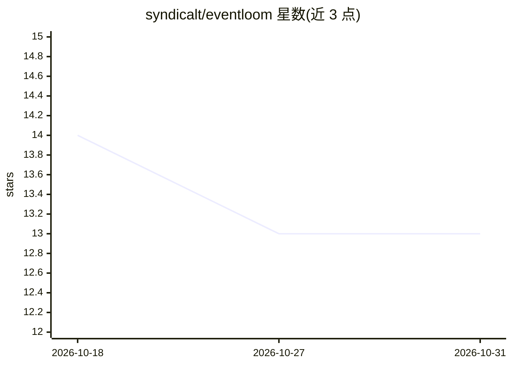

# syndicalt/eventloom

⭐ 13 · TypeScript · MIT · 推送 2026-06-02 · [GitHub](https://github.com/syndicalt/eventloom) · [官网](http://syndicalt.github.io/eventloom) · 个人维护

**多智能体系统的事件日志运行时：确定性重放与可观测性导出**

本地优先的 TypeScript 运行时，围绕 append-only JSONL 事件日志构建多智能体工作流。Actor 通过邮箱接收任务并发出结构化意图，由 orchestrator 校验后才追加事件；投影从日志重建状态，支持确定性重放、事后检查、防篡改哈希链校验、受损日志验证前缀恢复、human-in-the-loop 审批事件，以及模型/工具/推理摘要遥测记录。可将日志导出为 Pathlight、HALO、OTLP 遥测格式，并提供静态 HTML 可视化器与 MCP stdio 服务器包。以 npm 包、CLI 与 TypeScript API 形式提供，要求 Node >=20。

## 筛选速览

| 维度 | 判定 | 备注 |
|---|---|---|
| AI 角色 | `ai-ecosystem` | LLM/agent 周边工具 |
| 许可风险 | `permissive` | MIT |
| 部署形态 | `library` | 以包/库形式分发 |
| 模型依赖 | — | README 未给出锁定关系 |
| 硬件要求 | — | 无带数字的原话,不猜 |
| 安装摩擦 | `low` | 无编译、无系统依赖或容器化 |
| 成熟度 | — | 结构信号不足 |

## 能力要点

- append-only JSONL 事件日志与防篡改哈希链校验
- 意图校验后追加事件，投影重建状态支持确定性重放
- 导出 Pathlight / HALO / OTLP 遥测格式，附 integrity 报告
- MCP stdio 服务器包与静态 HTML 可视化器、artifact bundle

## 适用场景

- 为本地 agent 工作流记录可审计的事件日志并事后重放
- 将 agent 运行轨迹导出到 OpenTelemetry 兼容工具做分析
- 在多智能体工作流中加入人工审批节点

## 场景标签

`多智能体` `LLM 可观测性` · 领域:Agent 开发

## 证据(README 行号)

> L8: Eventloom is a local-first TypeScript runtime for multi-agent systems built around an append-only event log. It is a
> L12: Instead of treating an agent run as a linear `system/user/assistant` transcript, Eventloom models runtime state as 
> L14: Eventloom is designed for local development, deterministic replay, repository-local agent journals, and integration

## 星数曲线

2026-10-18 14 → 2026-10-31 13（-1）

---
*卡片 v1 · prompt 1.4 · 生成 2026-10-31 · 置信度 high · 依据 README sha `8baff2343335` · [字段定义](../../DATASET.md)*
