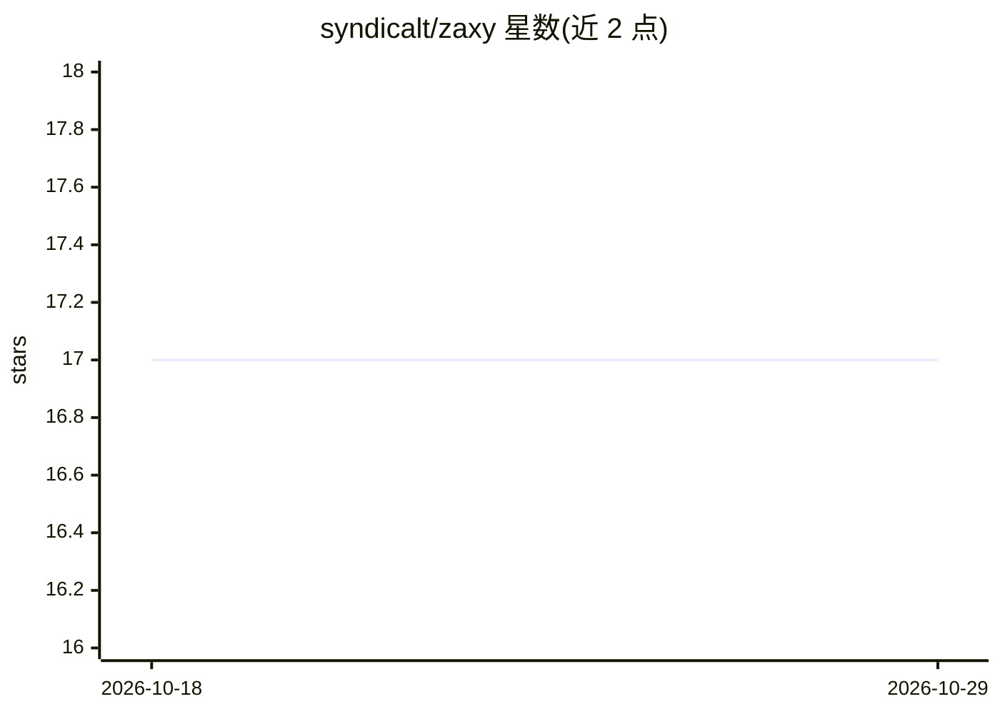

# syndicalt/zaxy

⭐ 17 · Python · MIT · 推送 2026-08-10 · [GitHub](https://github.com/syndicalt/zaxy) · [官网](http://docs.zaxy.io/) · 个人维护

**给多 agent 团队的可审计记忆层：哈希链日志+时序知识图**

面向 agent 团队的项目记忆系统：以 Eventloom 追加式 JSONL（SHA-256 哈希链）作为事实源，配合嵌入式 LadybugDB 双时态知识图做本地推理（Neo4j/Postgres 为可选 sidecar），记录父任务、worker 会话、工具观察、引用发现、冲突评审与合并回写。提供混合抽取（规则优先+LLM 回退）、混合检索（精确/关键词/向量/图遍历）、MCP 工具接口供 Codex、Claude Code、Cursor、LangGraph 等客户端使用。以 pipx 安装的 Python CLI（PyPI 包名 zaxy-memory），README 中声明此前的 LongMemEval 基准数字已撤回。

## 筛选速览

| 维度 | 判定 | 备注 |
|---|---|---|
| AI 角色 | `ai-ecosystem` | LLM/agent 周边工具 |
| 许可风险 | `permissive` | MIT |
| 部署形态 | `library` | 以包/库形式分发 |
| 模型依赖 | — | README 未给出锁定关系 |
| 硬件要求 | — | 无带数字的原话,不猜 |
| 安装摩擦 | `low` | 无编译、无系统依赖或容器化 |
| 成熟度 | — | 结构信号不足 |

## 能力要点

- Eventloom 追加式 JSONL 日志带 SHA-256 哈希链，构成不可变审计轨迹
- 双时态知识图：事实带 valid_from/valid_to 有效窗口
- 混合抽取与混合检索（精确+关键词+向量+图遍径，融合权重可配置）
- 默认本地嵌入式 LadybugDB 运行时，无需 sidecar；Neo4j/Pathlight 为可选安装

## 适用场景

- 让多 agent 协作的发现、评审与合并过程可回放、可审计
- 为 MCP 兼容的 agent 框架提供统一的持久记忆接口
- 对模型调用做来源追踪（OpenAI 兼容的 packet 分析器记录 llm.packet.completed 事件）

## 场景标签

`Agent 记忆` `多智能体` · 领域:Agent 开发

## 证据(README 行号)

> L26: - **MCP-native integration**: Codex, Claude Code, Cursor, VS Code, Hermes Agent,
> L165: - **MCP-native**: Drop-in memory for any MCP-compatible agent framework over stdio or SSE.
> L160: - **Immutable audit trail**: Eventloom append-only JSONL with SHA-256 hash chains.

## 星数曲线

2026-10-18 17 → 2026-10-29 17（+0）

---
*卡片 v1 · prompt 1.4 · 生成 2026-10-29 · 置信度 high · 依据 README sha `5d7a642b59ae` · [字段定义](../../DATASET.md)*
