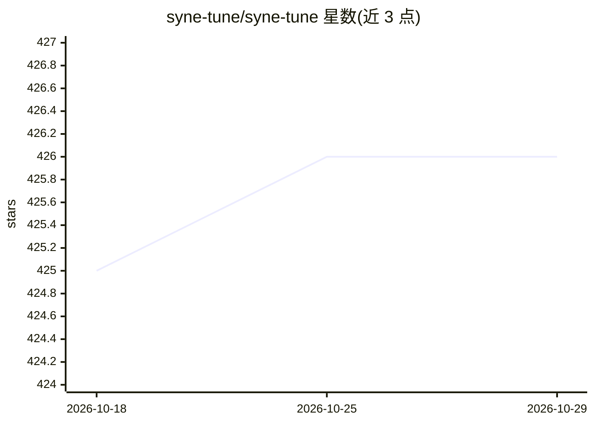

# syne-tune/syne-tune

⭐ 426 · Python · Apache-2.0 · 推送 2026-10-27 · [GitHub](https://github.com/syne-tune/syne-tune) · [官网](https://syne-tune.readthedocs.io) · 组织维护

**大规模超参数优化库：本地与 SLURM 集群上运行 HPO**

Syne Tune 是一个 Python 超参数优化（HPO）库，面向机器学习开发与研究人员。它提供多保真、多目标、迁移学习与基于种群训练的 HPO 方法，支持在本地或 SLURM 集群上并行运行大规模实验：每个 worker 启动独立 Python 进程评估一组超参配置。使用方式为在训练脚本中调用 report 上报指标，再由启动脚本定义搜索空间与调度器（如 ASHA）；也提供 ask/tell 接口嵌入自有训练循环或 Jupyter 环境。附带黑盒与表格基准集合用于 HPO 模拟，并可经 OptunaHub 作为 Optuna 的采样器使用。

## 筛选速览

| 维度 | 判定 | 备注 |
|---|---|---|
| AI 角色 | `ai-ecosystem` | LLM/agent 周边工具 |
| 许可风险 | `permissive` | Apache-2.0 |
| 部署形态 | `library` | 以包/库形式分发 |
| 模型依赖 | — | README 未给出锁定关系 |
| 硬件要求 | — | 无带数字的原话,不猜 |
| 安装摩擦 | `low` | 无编译、无系统依赖或容器化 |
| 成熟度 | — | 结构信号不足 |

## 能力要点

- 多保真、多目标、迁移学习与种群训练等 HPO 方法
- 本地或 SLURM 集群上的大规模并行实验工具
- ask/tell 接口可嵌入自有训练循环（如 Jupyter notebook）
- 包含代理与表格黑盒基准集合，可作 Optuna 采样器（OptunaHub）

## 适用场景

- 调优自己训练脚本的超参数并并行评估多组配置
- 在 SLURM 集群上运行大规模超参搜索实验
- 用黑盒基准对 HPO 方法做基准测试

## 场景标签

`MLOps` · 领域:训练与推理

## 证据(README 行号)

> L14: Syne Tune is a library for large-scale hyperparameter optimization (HPO) with the following key features:
> L16: - State-of-the-art HPO methods for multi-fidelity optimization, multi-objective optimization, transfer learning, an
> L18: - Tooling that lets you run large-scale experimentation either locally or on SLURM clusters.

## 星数曲线

2026-10-18 425 → 2026-10-29 426（+1）

---
*卡片 v1 · prompt 1.4 · 生成 2026-10-21 · 置信度 high · 依据 README sha `321c643dfb9a` · [字段定义](../../DATASET.md)*
