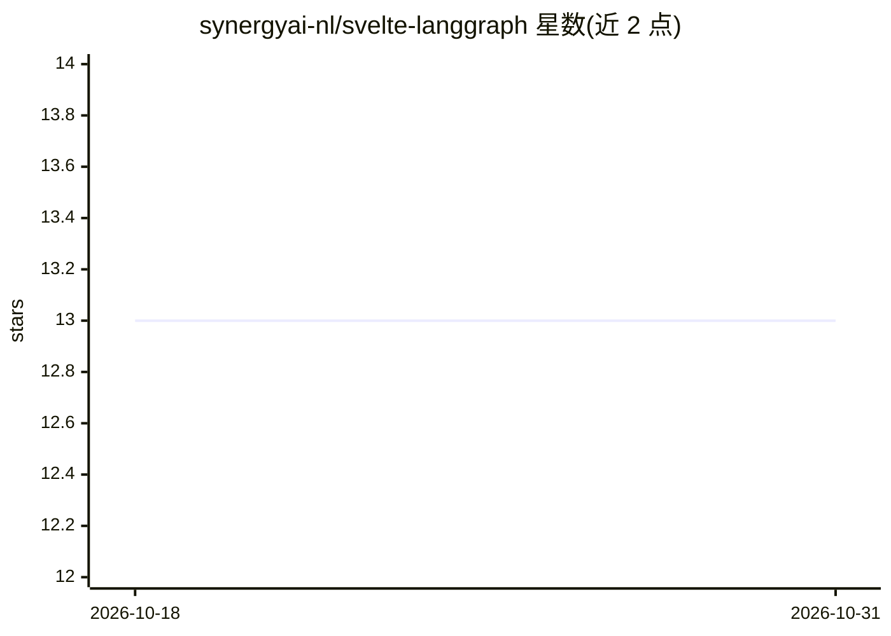

# synergyai-nl/svelte-langgraph

⭐ 13 · TypeScript · Unlicense · 推送 2026-10-26 · [GitHub](https://github.com/synergyai-nl/svelte-langgraph) · [官网](https://svelte-langgraph-demo.synergyai.nl/) · 组织维护

**LangGraph agent 的 SvelteKit 前端与 Aegra 服务端全栈模板**

面向 LangGraph agent 的全栈工程模板：前端为 SvelteKit + TypeScript + Tailwind + shadcn/bits-ui，后端为 Python 3.12 上的 Aegra（自托管 Agent Protocol 服务端，SDK 兼容 LangGraph Platform）+ PostgreSQL，含 OIDC 认证与多语言支持。通过 OpenAI 兼容环境变量接入 OpenAI/OpenRouter/Ollama 等模型，前端可折叠展示推理 token。使用 Proto+moon+pnpm 管理工具链，需 PostgreSQL ≥ 13（Docker 可选），提供 Docker Compose 生产部署与 Playwright E2E 测试。

## 筛选速览

| 维度 | 判定 | 备注 |
|---|---|---|
| AI 角色 | `ai-ecosystem` | LLM/agent 周边工具 |
| 许可风险 | `permissive` | Unlicense |
| 部署形态 | `self-host` | docker 或自建部署 |
| 模型依赖 | local-ok | 支持本地模型 |
| 硬件要求 | — | 无带数字的原话,不猜 |
| 安装摩擦 | `low` | 无编译、无系统依赖或容器化 |
| 成熟度 | — | 结构信号不足 |

## 能力要点

- SvelteKit 前端 + Aegra（Agent Protocol）后端 + PostgreSQL 的完整架构
- OpenAI/OpenRouter/Ollama 等 OpenAI 兼容提供商切换
- 前端展示 LLM reasoning/thinking token（可折叠块）
- 内置 OIDC 认证（含本地 mock provider）与多语言（Paraglide-JS）

## 适用场景

- 为已有 LangGraph agent 快速搭建带认证的聊天前端
- 自托管 LangGraph agent 服务与 Web 界面的起点工程
- 本地或生产环境运行 OpenAI 兼容模型的 agent 应用

## 场景标签

`Agent 框架` · 领域:Agent 开发

## 证据(README 行号)

> L7: Opinionated SvelteKit-based LLM frontend for LangGraph agents, served by Aegra — an open-source, self-hosted Agent P
> L14: - **Backend**: Python 3.12 + Aegra (open-source Agent Protocol server) running LangGraph workflows, backed by Postg
> L254: - Aegra as the Agent Protocol server (FastAPI + PostgreSQL), SDK-compatible with LangGraph Platform

## 星数曲线

2026-10-18 13 → 2026-10-31 13（+0）

---
*卡片 v1 · prompt 1.4 · 生成 2026-10-31 · 置信度 mid · 依据 README sha `287d0a248f1c` · [字段定义](../../DATASET.md)*
