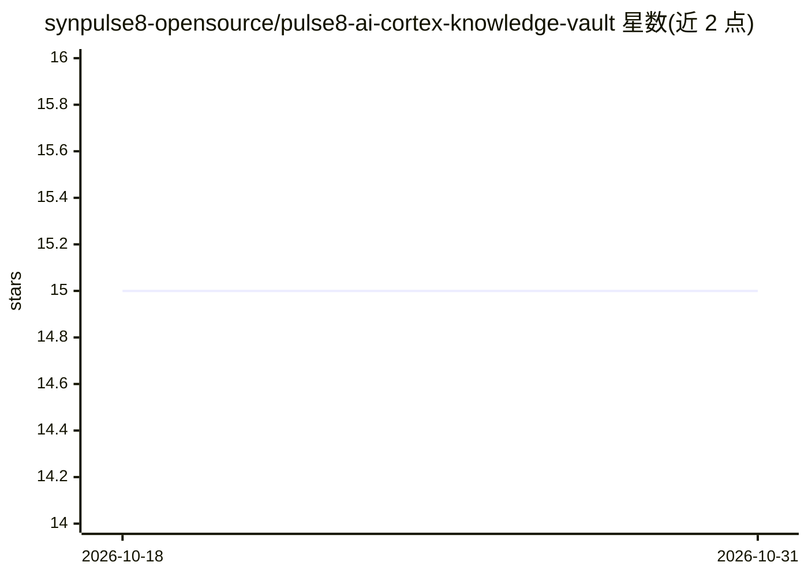

# synpulse8-opensource/pulse8-ai-cortex-knowledge-vault

⭐ 15 · Python · Apache-2.0 · 推送 2026-07-27 · [GitHub](https://github.com/synpulse8-opensource/pulse8-ai-cortex-knowledge-vault) · [官网](https://www.synpulse8.com/en/our-solutions/pulse8#pulse8-ai) · 组织维护

**面向 AI agent 的 Markdown 知识库层：图谱+搜索+MCP**

开源的 agent 知识层：以纯 Markdown 目录为存储（无数据库），内置基于 NetworkX 的类型化知识图谱、QMD 混合搜索（BM25+向量+重排）、MarkItDown 文件编译（PDF/DOCX/PPTX/XLSX/HTML/图片转 Markdown），通过 MCP（HTTP/stdio）与 REST API 供 Claude Desktop、Cursor、LangChain 等客户端读写知识。读写/编译事件记录为 wikilink 时间线，边带 extracted/inferred/manual 溯源标注。确定性优先：摄取、图谱、搜索均可零 LLM 运行，LLM 仅用于可选的交叉引用/打标/图像描述，后端支持 OpenAI 兼容端点（OpenRouter/Ollama/vLLM/LM Studio）、AWS Bedrock 或 none 模式。需 Docker 启动；发布 LongMemEval-S 基准（总体 45.0% 准确率）。

## 筛选速览

| 维度 | 判定 | 备注 |
|---|---|---|
| AI 角色 | `ai-ecosystem` | LLM/agent 周边工具 |
| 许可风险 | `permissive` | Apache-2.0 |
| 部署形态 | `self-host` | docker 或自建部署 |
| 模型依赖 | local-ok | 支持本地模型 |
| 硬件要求 | — | 无带数字的原话,不猜 |
| 安装摩擦 | `low` | 无编译、无系统依赖或容器化 |
| 成熟度 | — | 结构信号不足 |

## 能力要点

- 纯 Markdown 存储 + 类型化知识图谱，Git 原生版本化，零数据库
- MCP（HTTP/stdio）+ REST API 双通道，兼容任意 MCP 客户端
- 摄取/图谱/搜索零 LLM 调用即可运行，LLM 为可选增强（支持 OpenAI 兼容、Bedrock、none 后端）
- 边级溯源标注（extracted/inferred/manual）与 vault_trace 溯源到源文档

## 适用场景

- 为多个 AI agent 提供共享的持久化记忆与知识库
- 组织知识以 Git 版本化，人与 agent 在同一 vault 上协作
- 批量导入文档编译为 Markdown 并构建可查询的知识图谱

## 场景标签

`知识库管理` `知识图谱` `Agent 记忆` · 领域:Agent 开发

## 证据(README 行号)

> L19: PULSE8.ai Cortex is the **open-source knowledge layer for AI agents**: Git-native memory, a typed knowledge graph, 
> L37: - **Share knowledge through MCP** — one vault, every MCP-compatible client
> L157: |**MCP Server**|Streamable HTTP + stdio transport — works with Claude Desktop, Cursor, and any MCP client|

## 星数曲线

2026-10-18 15 → 2026-10-31 15（+0）

---
*卡片 v1 · prompt 1.4 · 生成 2026-10-30 · 置信度 mid · 依据 README sha `d28fffb94f1b` · [字段定义](../../DATASET.md)*
