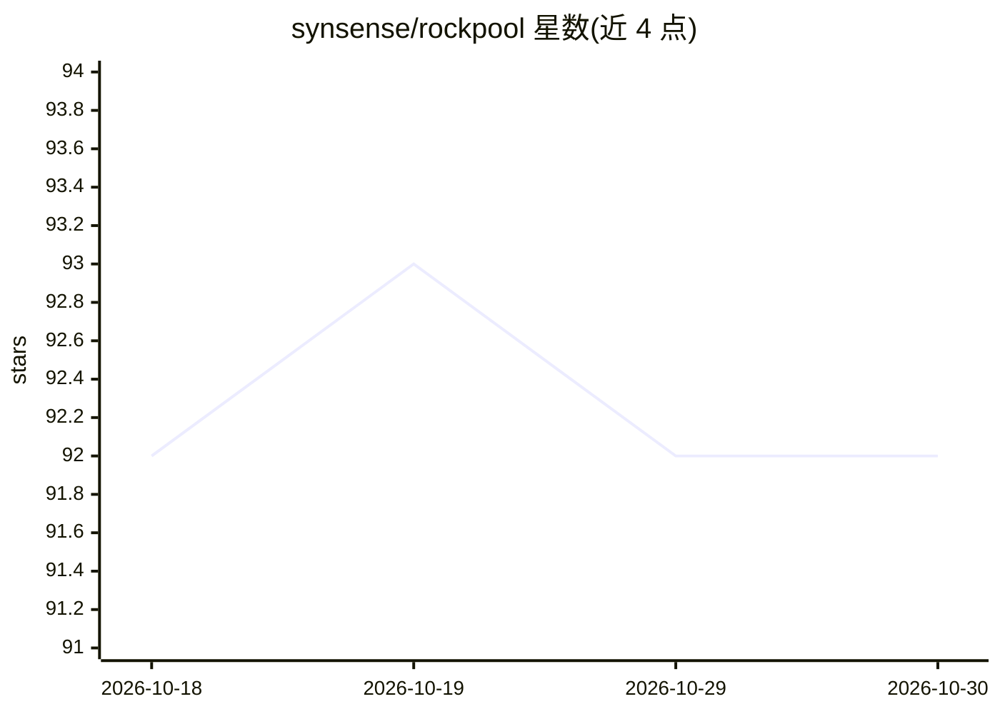

# synsense/rockpool

⭐ 92 · Python · AGPL-3.0 · 推送 2026-07-03 · [GitHub](https://github.com/synsense/rockpool) · [官网](https://rockpool.ai) · 组织维护

**面向脉冲神经网络的机器学习库：构建/训练/部署**

Rockpool 是一个用于开发脉冲神经网络（SNN）信号处理应用的 Python 库，支持构建网络、仿真、训练与测试，并可部署到仿真或事件驱动神经形态计算硬件。它提供多种仿真后端的层：Brian2、Torch、JAX、Numba 与 numpy，支持基于 torch 和 jax 管线的训练。定位是简化基于 SNN 的机器学习，不做生物网络细节仿真。通过 pip 安装，AGPL 许可并可选申请商业许可。

## 筛选速览

| 维度 | 判定 | 备注 |
|---|---|---|
| AI 角色 | `ai-native` | 本体是模型或模型工具 |
| 许可风险 | `dual` | AGPL-3.0 |
| 部署形态 | `library` | 以包/库形式分发 |
| 模型依赖 | — | README 未给出锁定关系 |
| 硬件要求 | — | 无带数字的原话,不猜 |
| 安装摩擦 | `low` | 无编译、无系统依赖或容器化 |
| 成熟度 | — | 结构信号不足 |

## 能力要点

- 支持多仿真后端：Brian2、Torch、JAX、Numba、numpy
- 支持 torch 和 jax 训练管线
- 可部署到仿真或事件驱动神经形态计算硬件

## 适用场景

- 构建和训练脉冲神经网络做信号处理
- 将 SNN 模型部署到神经形态硬件
- 在不同仿真后端间切换进行实验

## 场景标签

`模型训练` `推理引擎` · 领域:训练与推理

## 证据(README 行号)

> L7: Rockpool is a Python package for developing signal processing applications with spiking neural networks. Rockpool al

## 星数曲线

2026-10-18 92 → 2026-10-30 92（+0）

---
*卡片 v1 · prompt 1.4 · 生成 2026-10-23 · 置信度 high · 依据 README sha `05ebc32457b6` · [字段定义](../../DATASET.md)*
