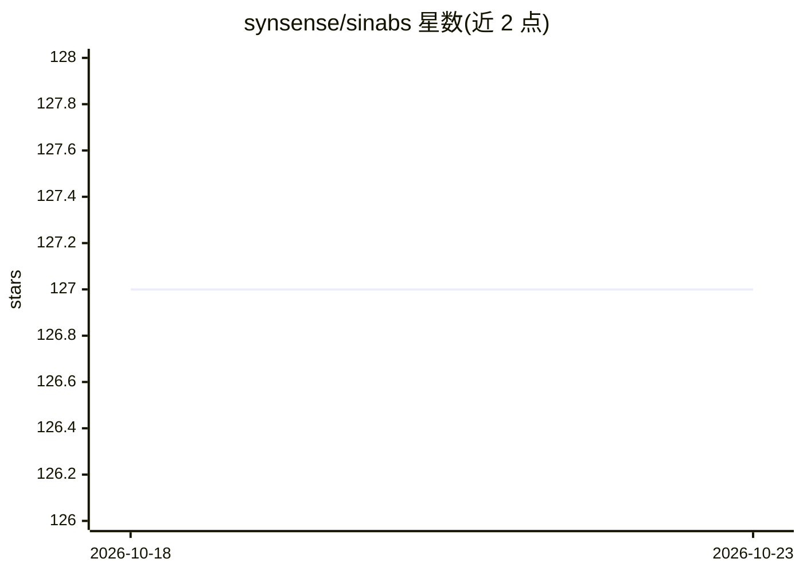

# synsense/sinabs

⭐ 127 · Python · Apache-2.0 · 推送 2026-02-05 · [GitHub](https://github.com/synsense/sinabs) · [官网](https://sinabs.readthedocs.io) · 组织维护

**基于 PyTorch 的脉冲神经网络库，支持神经形态硬件部署**

Sinabs 是一个用于开发与实现脉冲卷积神经网络（SCNN）的 Python 库，基于 PyTorch，实现了多种 CNN 层的脉冲等效层，并支持将 torch 实现的 CNN 模型导入以测试其脉冲等效实现。项目由 SynSense（前 aiCTX AG）管理；并入的 sinabs-dynapcnn 支持将模型移植到采用 DYNAP-CNN 技术的芯片与开发套件。通过 pip/conda 安装，文档托管于 readthedocs，采用 Apache v2.0 许可。

## 筛选速览

| 维度 | 判定 | 备注 |
|---|---|---|
| AI 角色 | `ai-native` | 本体是模型或模型工具 |
| 许可风险 | `permissive` | Apache-2.0 |
| 部署形态 | `library` | 以包/库形式分发 |
| 模型依赖 | — | README 未给出锁定关系 |
| 硬件要求 | — | 无带数字的原话,不猜 |
| 安装摩擦 | `low` | 无编译、无系统依赖或容器化 |
| 成熟度 | — | 结构信号不足 |

## 能力要点

- 提供 CNN 层的脉冲（spiking）等效层实现
- 支持导入 torch CNN 模型测试脉冲等效实现
- sinabs-dynapcnn 支持移植模型到 DYNAP-CNN 芯片与开发套件

## 适用场景

- 构建与训练脉冲卷积神经网络
- 将已有 PyTorch CNN 模型转换为脉冲等效实现
- 把 SNN 模型部署到 DYNAP-CNN 神经形态硬件

## 场景标签

 · 领域:神经形态计算/深度学习库

## 证据(README 行号)

> L8: Sinabs (Sinabs Is Not A Brain Simulator) is a python library for the development and implementation of Spiking Convo
> L9: The library implements several layers that are `spiking` equivalents of CNN layers.
> L13: The `sinabs-dynapcnn` was incorporated to this project, and it enables porting sinabs models to chips and dev-kits 

## 星数曲线

2026-10-18 127 → 2026-10-23 127（+0）

---
*卡片 v1 · prompt 1.4 · 生成 2026-10-23 · 置信度 high · 依据 README sha `5342432e7c70` · [字段定义](../../DATASET.md)*
