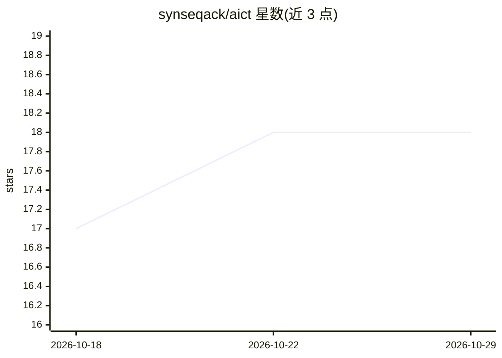

# synseqack/aict

⭐ 18 · Go · MIT · 推送 2026-09-19 · [GitHub](https://github.com/synseqack/aict) · [官网](https://synseqack.github.io/aict/) · 个人维护

**供 AI agent 直接调用的结构化输出 Unix 工具集（34 个工具）**

用 Go 重新实现 34 个 Unix 工具（ls/grep/find/diff/awk 等），默认输出 XML（可选 JSON/plain），字段显式标注、路径绝对化、自动检测语言与 MIME 类型，供 AI agent 免解析直接读取。内置 MCP server 子命令（aict mcp），可接入 Claude Desktop / Claude Code 作为原生函数调用。README 给出 token 消耗与性能基准：单任务 token 数高于 GNU 工具 1.1–7.8 倍，但减少往返次数；部分工具较 GNU 慢（grep 慢约 96 倍）。严格只读、无网络请求、无遥测；依赖仅 MCP Go SDK。macOS 经 Homebrew 安装，也可 go install 或源码构建；Windows 支持大部分工具，ps 仅限 Linux。

## 筛选速览

| 维度 | 判定 | 备注 |
|---|---|---|
| AI 角色 | `ai-ecosystem` | LLM/agent 周边工具 |
| 许可风险 | `permissive` | MIT |
| 部署形态 | `library` | 以包/库形式分发 |
| 模型依赖 | — | README 未给出锁定关系 |
| 硬件要求 | — | 无带数字的原话,不猜 |
| 安装摩擦 | `low` | 无编译、无系统依赖或容器化 |
| 成熟度 | — | 结构信号不足 |

## 能力要点

- 34 个 Unix 工具输出结构化 XML/JSON，字段标注、绝对路径、自动语言/MIME 检测
- 内置 MCP server（aict mcp，stdio 传输），提供 Claude Desktop / Claude Code 接入配置
- 紧凑模式用短属性名节省 token，--plain 可回退纯文本输出
- 严格只读：无网络请求、无遥测，除 MCP SDK 外全部使用 Go 标准库

## 适用场景

- 让 AI agent 用一次调用替代多次链式 shell 调用获取结构化文件信息
- 通过 MCP 把 ls/grep/diff 等暴露为 agent 可调用的原生函数
- 沙箱环境中安全地执行只读文件检查与搜索

## 场景标签

 · 领域:开发者工具/AI agent 基础设施

## 证据(README 行号)

> L3: **Unix coreutils with XML/JSON output — built for AI agents, not humans.**
> L105: `aict mcp` exposes all tools as callable MCP functions via stdio transport. AI assistants call them natively — no 
> L136: Once connected, Claude Code can call `ls`, `grep`, `diff`, and all other tools as native functions with typed argu

## 星数曲线

2026-10-18 17 → 2026-10-29 18（+1）

---
*卡片 v1 · prompt 1.4 · 生成 2026-10-29 · 置信度 high · 依据 README sha `ec1a11353867` · [字段定义](../../DATASET.md)*
