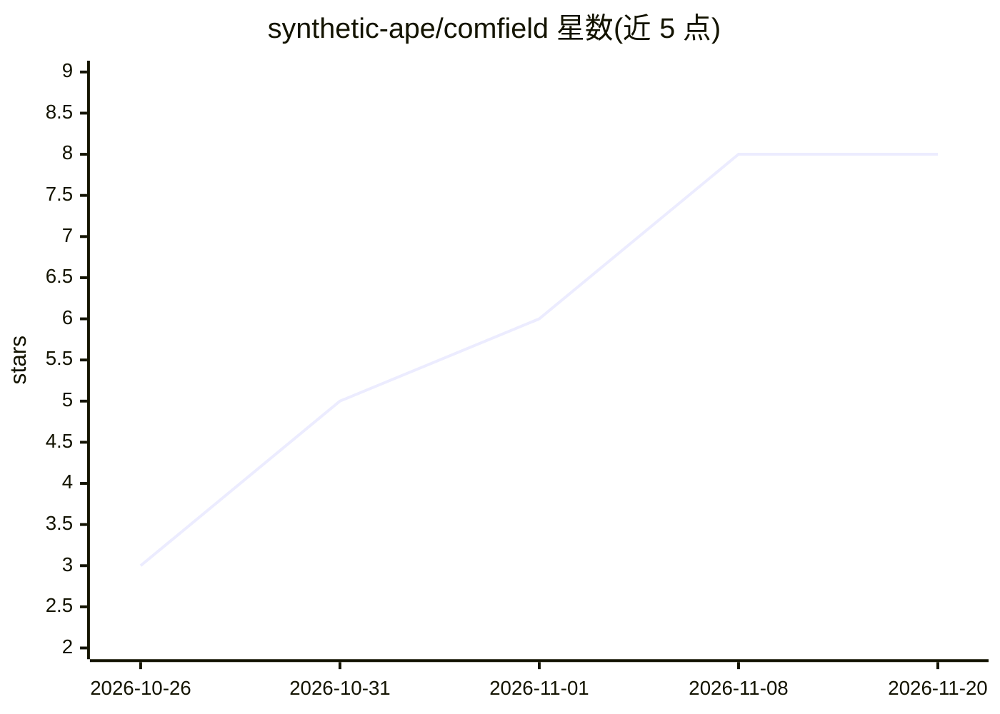

# synthetic-ape/comfield

⭐ 8 · TypeScript · MIT · 推送 2026-10-16 · [GitHub](https://github.com/synthetic-ape/comfield) · 个人维护

**开源 AI 图像与视频创作工作室：提示词生成镜头级成品**

基于 Comfy 开发平台（Comfy Router + Comfy SDK）的本地 Node 服务器 + React 应用，为创作者提供图像与视频生成工作室：文本生成图像/视频、图像编辑（最多 10 张参考图）、首尾帧视频、27 种镜头运动预设、景别/镜头/灯光控制、每次生成含最多 4 个 take 的任务管理。模型走两条路径：9-10 个云端模型（经 Comfy Router 付费调用）或 5 个开源权重模型跑在本机 GPU 的 ComfyUI 上；无 GPU 时可切到 Comfy Cloud。本地运行需 Comfy Desktop 与 Python 3.10+，视频模型对系统内存要求高。

## 筛选速览

| 维度 | 判定 | 备注 |
|---|---|---|
| AI 角色 | `ai-native` | 本体是模型或模型工具 |
| 许可风险 | `permissive` | MIT |
| 部署形态 | `library` | 以包/库形式分发 |
| 模型依赖 | — | README 未给出锁定关系 |
| 硬件要求 | `gpu-8g` | |
| 安装摩擦 | `low` | 无编译、无系统依赖或容器化 |
| 成熟度 | — | 结构信号不足 |

## 能力要点

- 图像与视频双工作室，支持文生图/图生视频/首尾帧视频与同步音轨
- 27 种镜头运动预设与景别、镜头、景深、灯光的电影化控制
- 同一界面调度云端模型（Comfy Router）与本机 GPU 开源权重模型
- 模型页管理 ComfyUI 模板库约 75 个开源模型家族的下载（进度/取消/续传/磁盘空间检查）

## 适用场景

- 用提示词与镜头控制生成带运镜的视频片段
- 用本机 GPU 免云端费用跑开源权重模型出图出片
- 对图片做多参考图编辑并一键动画化为视频

## 场景标签

`图像生成` `视频生成` · 领域:内容生成

## 证据(README 行号)

> L3: **An open-source, Higgsfield-style creative studio for AI images and video, built on the Comfy Developer Platform.**
> L5: Write a prompt, pick a model, choose a camera move, get takes back. Run frontier models through **Comfy Router**, or
> L21: |**Image studio**|Text-to-image and image editing with up to 10 reference images. 2 open-weights models on your GPU

## 星数曲线

2026-10-26 3 → 2026-11-20 8（+5）

---
*卡片 v1 · prompt 1.4 · 生成 2026-11-20 · 置信度 high · 依据 README sha `973c689ce196` · [字段定义](../../DATASET.md)*
