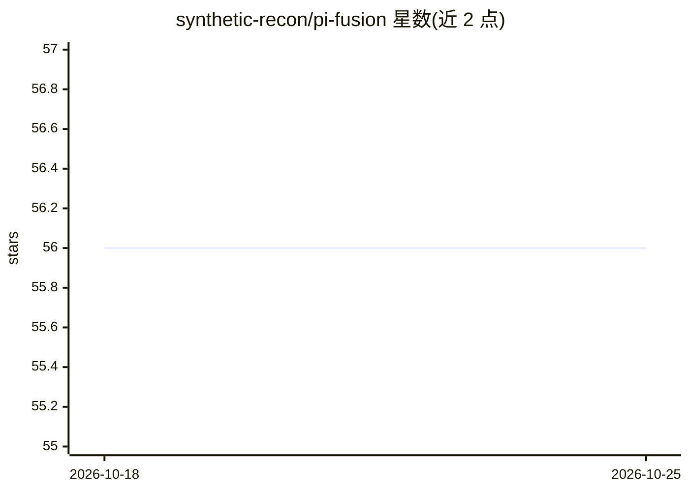

# synthetic-recon/pi-fusion

⭐ 56 · TypeScript · MIT · 推送 2026-10-14 · [GitHub](https://github.com/synthetic-recon/pi-fusion) · [官网](https://www.npmjs.com/package/pi-fusion) · 组织维护

**pi 编码助手的扩展：多模型合议评审后由主模型作答**

pi 终端编码助手的扩展包，安装后提供 fusion 工具：将提示并行发送给多个已认证模型组成的小组，由裁判模型汇总结构化分析（共识/分歧/盲点等），再交回当前活跃模型撰写最终回答。默认 available 模式由模型自行判断何时调用；面板、裁判、工具权限、token 预算均由用户通过 /fusion-setup 或 fusion.json 配置，调用模型无法覆盖。多模型运行会增加延迟与 token 花费；需要 Node ≥ 22.19.0 与 Pi ≥ 0.80.6。

## 筛选速览

| 维度 | 判定 | 备注 |
|---|---|---|
| AI 角色 | `ai-ecosystem` | LLM/agent 周边工具 |
| 许可风险 | `permissive` | MIT |
| 部署形态 | `library` | 以包/库形式分发 |
| 模型依赖 | — | README 未给出锁定关系 |
| 硬件要求 | — | 无带数字的原话,不猜 |
| 安装摩擦 | `low` | 无编译、无系统依赖或容器化 |
| 成熟度 | — | 结构信号不足 |

## 能力要点

- 并行征询多个已认证模型并由裁判模型输出共识/分歧/盲点结构化分析
- 无配置即可启动：自动选择跨提供商的多样化面板
- 面板模型可启用只读/全部工具以先取证再作答（多轮、有预算上限）
- 配置（面板/裁判/工具/预算）仅归用户，调用方模型不可覆盖

## 适用场景

- 为架构决策、研究评估等高代价问题获取多模型第二/第三意见
- 查看不同模型间的真实分歧与各自盲点
- 在 pi 助手中按会话或单条提示灵活开启/关闭合议

## 场景标签

`编码 Agent` · 领域:编码与开发

## 证据(README 行号)

> L3: Multi-model deliberation for pi, inspired by OpenRouter Fusion.
> L5: pi-fusion sends your prompt to several of the models you're already authed for, then has a judge model compare their
> L34: pi install npm:pi-fusion                            # from npm

## 星数曲线

2026-10-18 56 → 2026-10-25 56（+0）

---
*卡片 v1 · prompt 1.4 · 生成 2026-10-24 · 置信度 high · 依据 README sha `34cf1699732d` · [字段定义](../../DATASET.md)*
