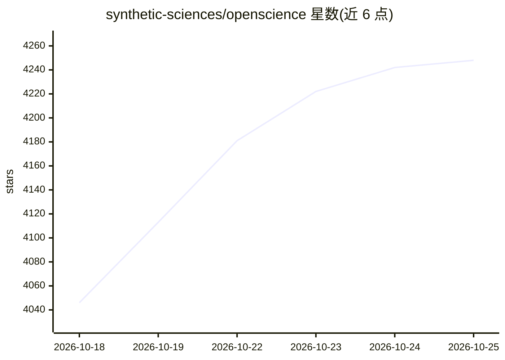

# synthetic-sciences/openscience

⭐ 4,248 · TypeScript · Apache-2.0 · 推送 2026-10-23 · [GitHub](https://github.com/synthetic-sciences/openscience) · [官网](https://openscience.sh) · 组织维护

**开源科研 AI 工作台：给定目标后自主查文献、写跑代码并成文**

以桌面应用、浏览器工作区或 CLI 形式运行在用户本机的科研 agent 工作台：用自然语言描述任务，agent 规划并执行检索文献、运行 Shell/Python/R 内核、跑实验、撰写结果，全程留痕可查。捆绑数百个覆盖生物、化学、物理、ML 的技能，连接 ChEMBL、UniProt、PubMed、arXiv 等数据库，支持主 agent 向并行 worker 分派有界任务。模型接入支持自带 API key、Ollama/LM Studio 本地模型或托管的 Ace 按量付费选项；文件与网络操作需显式授权。

## 筛选速览

| 维度 | 判定 | 备注 |
|---|---|---|
| AI 角色 | `ai-native` | 本体是模型或模型工具 |
| 许可风险 | `permissive` | Apache-2.0 |
| 部署形态 | `library` | 以包/库形式分发 |
| 模型依赖 | local-ok | 支持本地模型 |
| 硬件要求 | — | 无带数字的原话,不猜 |
| 安装摩擦 | `low` | 无编译、无系统依赖或容器化 |
| 成熟度 | — | 结构信号不足 |

## 能力要点

- 自然语言驱动的研究 agent：计划、取证、跑代码与实验、产出结果
- 数百个捆绑科学技能与 ChEMBL/UniProt/PubMed/arXiv 等数据库连接器
- 主 agent 可向并行 worker 分派有界任务并保留最终裁决
- 桌面应用/浏览器工作区/CLI 三种形态，模型可自带 key 或本地运行

## 适用场景

- 让 agent 检查数据质量、写分析代码并生成可复现的报告
- 复现文献中的实验结论并对比测量结果
- 文献综述、比较发现并保存引用证据
- 把日常数据清理、参数扫描等研究杂务交给 agent 执行

## 场景标签

`科研工具` · 领域:学习与行业

## 证据(README 行号)

> L18: OpenScience is a research agent with a workbench around it. You describe the task in plain language; it plans, gath
> L5: Give it a goal. It reads the literature, writes and runs the code, runs the experiments, and writes up what it found

## 星数曲线

2026-10-18 4,046 → 2026-10-25 4,248（+202）

---
*卡片 v1 · prompt 1.4 · 生成 2026-10-20 · 置信度 high · 依据 README sha `69cc3b16d9eb` · [字段定义](../../DATASET.md)*
