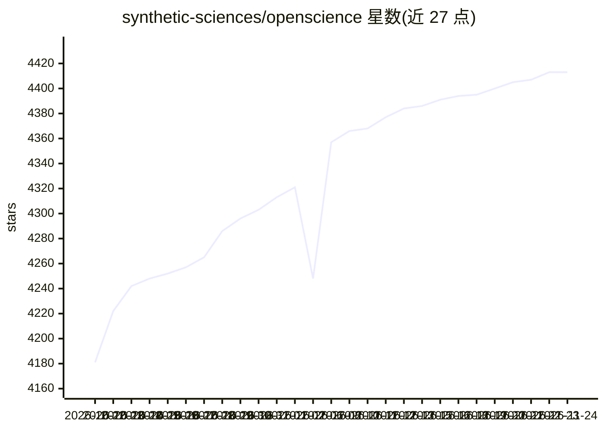

# synthetic-sciences/openscience

⭐ 4,423 · TypeScript · Apache-2.0 · 推送 2026-11-23 · [GitHub](https://github.com/synthetic-sciences/openscience) · [官网](https://openscience.sh) · 组织维护

**科研工作台的 AI 研究 agent：读文献、跑实验、写报告**

OpenScience 是面向科研的 agent 与工作台：用户用自然语言描述任务，它规划、检索文献、编写并运行代码和实验、产出可核查的结果与完整执行轨迹。支持桌面应用、浏览器工作区和终端 CLI 三种形态，本地运行于用户机器并直接操作项目文件。提供 shell/Python/R 内核、文件读写授权、数百个科学技能包及 ChEMBL/UniProt/PubMed/arXiv 等数据库连接器；主 agent 可将任务分派给并行的 worker。模型接入支持自有 API key、本地模型（Ollama/LM Studio）或托管的按量计费 Ace。

## 筛选速览

| 维度 | 判定 | 备注 |
|---|---|---|
| AI 角色 | `ai-native` | 本体是模型或模型工具 |
| 许可风险 | `permissive` | Apache-2.0 |
| 部署形态 | `library` | 以包/库形式分发 |
| 模型依赖 | local-ok | 支持本地模型 |
| 硬件要求 | — | 无带数字的原话,不猜 |
| 安装摩擦 | `low` | 无编译、无系统依赖或容器化 |
| 成熟度 | — | 结构信号不足 |

## 能力要点

- 每一步操作（思考/搜索/执行/写文件）记录为可回看的 trace
- 内置数百个覆盖生物/化学/物理/ML/数据工程的技能，连接 ChEMBL、UniProt、PubMed、arXiv 等数据库
- 本地 Python/R 内核，远程算力支持 Modal、SSH、Slurm/PBS 集群
- 文件读写与网络命令的显式授权机制，主 agent 分派 worker 并行执行

## 适用场景

- 检索文献并整理带引用的证据
- 检查数据缺失值、跑分析代码并生成图表报告
- 复现实验声明并比对测量结果
- 通过 Modal/SSH/Slurm 调度 GPU 长任务

## 场景标签

`科研工具` `Agent 框架` · 领域:Agent 开发

## 证据(README 行号)

> L18: OpenScience is a research agent with a workbench around it. You describe the task in plain language; it plans, gath
> L5: Give it a goal. It reads the literature, writes and runs the code, runs the experiments, and writes up what it found

## 星数曲线

2026-10-22 4,181 → 2026-11-24 4,413（+232）

---
*卡片 v1 · prompt 1.4 · 生成 2026-11-23 · 置信度 high · 依据 README sha `95c7cb799b96` · [字段定义](../../DATASET.md)*
