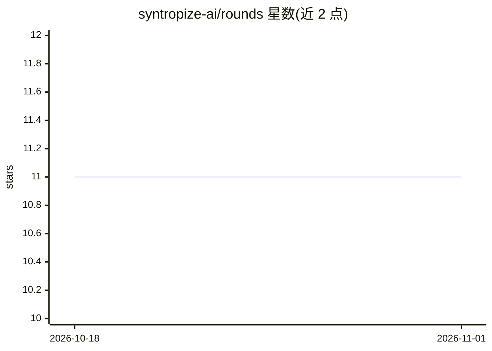

# syntropize-ai/rounds

⭐ 11 · TypeScript · NOASSERTION · 推送 2026-07-26 · [GitHub](https://github.com/syntropize-ai/rounds) · 组织维护

**自托管 AI SRE：用自然语言做告警调查、仪表盘与审批修复**

部署在 Kubernetes 上的自托管 AI SRE 应用：接入 Prometheus 等数据源后，用户以自然语言创建/编辑仪表盘、配置并回测告警规则、调查事故（关联指标/日志/变更/K8s 状态，每条结论带引用），并提出修复方案——用户动作在聊天中确认，后台 agent 动作走正式审批（Approve/Reject/Modify）并通知负责人。支持 Anthropic/OpenAI/Gemini/DeepSeek/Azure/本地 Ollama 作为模型后端，Helm 安装，无集群时可 npx 单机体验（SQLite，默认无鉴权，仅限评估）。计划中的集成（Loki、Jira、PagerDuty 等）在文档中标注 PLANNED。

## 筛选速览

| 维度 | 判定 | 备注 |
|---|---|---|
| AI 角色 | `ai-native` | 本体是模型或模型工具 |
| 许可风险 | `none` | NOASSERTION |
| 部署形态 | `library` | 以包/库形式分发 |
| 模型依赖 | local-ok | 支持本地模型 |
| 硬件要求 | — | 无带数字的原话,不猜 |
| 安装摩擦 | `low` | 无编译、无系统依赖或容器化 |
| 成熟度 | — | 结构信号不足 |

## 能力要点

- 自然语言创建仪表盘与告警规则（含预览与回测）
- 事故调查关联指标/日志/变更/K8s 状态，结论带引用
- 修复动作分级审批：聊天确认与正式 Approve/Reject/Modify 流程
- Helm 部署到 Kubernetes，或 npx 单机运行（SQLite）

## 适用场景

- 值班时用自然语言查询'checkout 延迟为什么高'并得到带引用的分析
- 通过对话快速搭建监控仪表盘和告警规则
- 让 AI 提出修复方案并在审批后自动执行

## 场景标签

`数据分析` · 领域:效率与自动化

## 证据(README 行号)

> L4:  Self-hosted AI SRE — investigate incidents, build dashboards, manage alerts, and approve remediations from natural 
> L24: OpenAI, Gemini, DeepSeek, Azure OpenAI, or a local Ollama endpoint). Rounds

## 星数曲线

2026-10-18 11 → 2026-11-01 11（+0）

---
*卡片 v1 · prompt 1.4 · 生成 2026-11-01 · 置信度 high · 依据 README sha `f58acbb81b34` · [字段定义](../../DATASET.md)*
