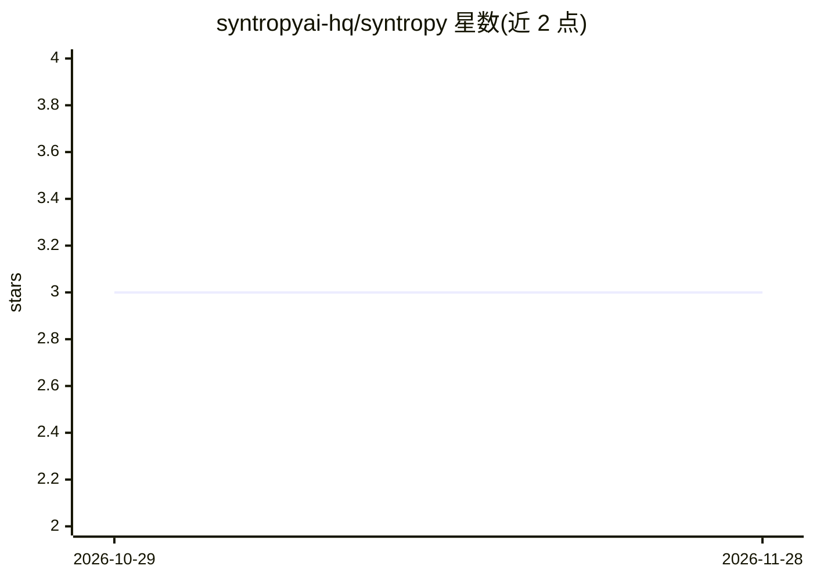

# syntropyai-hq/syntropy

⭐ 3 · Rust · Apache-2.0 · 推送 2026-11-08 · [GitHub](https://github.com/syntropyai-hq/syntropy) · 组织维护

**把多台机器的 GPU/内存/NVMe 拼成一台来跑大模型的推理平台**

Rust 编写的分布式 LLM 推理与 agent 编排平台，设计目标是把多台设备的多层存储（VRAM/RAM/NVMe）当作一台计算机，按实测带宽为整个模型选择权重放置，机器间以流水线环传递隐状态。提供 OpenAI/Anthropic 形状的 API 与原生 API，默认输出与参考前向一致。当前处于 pre-alpha 里程碑 M0a，README 明确声明尚无可安装的版本，全部内容为设计与规划。MIT OR Apache-2.0 双许可。

## 筛选速览

| 维度 | 判定 | 备注 |
|---|---|---|
| AI 角色 | `ai-ecosystem` | LLM/agent 周边工具 |
| 许可风险 | `permissive` | Apache-2.0 |
| 部署形态 | `None` |  |
| 模型依赖 | — | README 未给出锁定关系 |
| 硬件要求 | `cpu-ok` | |
| 安装摩擦 | `medium` | 含编译或系统依赖之一 |
| 成熟度 | `idea` | |

## 能力要点

- 按实测硬件带宽决定整个模型的权重放置，而非查规格表
- 跨机器流水线环执行，仅激活值在机器间传输
- OpenAI 与 Anthropic 形状 API，现有客户端无需改动
- 快捷方式 opt-in 且命名，默认输出与参考一致

## 适用场景

- 把家中多台设备的闲置显存与内存合并运行单个大模型
- 在无法单机装下的大参数 MoE 模型上做本地推理
- 为现有 OpenAI/Anthropic 客户端提供本地推理后端

## 场景标签

`推理引擎` · 领域:训练与推理

## 证据(README 行号)

> L22: > **Syntropy is being built, and there is nothing to install yet.** The complete design is in `plan/`, and implemen
> L51: - **The APIs your tools already use.** OpenAI- and Anthropic-shaped APIs and a native one, served from whichever ma
> L80: Tier 1: supported Linux x86_64 with NVIDIA, Windows 11 x86_64 with NVIDIA, macOS 15+ on Apple silicon, and CPU-only

## 星数曲线

2026-10-29 3 → 2026-11-28 3（+0）

---
*卡片 v1 · prompt 1.4 · 生成 2026-11-21 · 置信度 high · 依据 README sha `4200764ad31e` · [字段定义](../../DATASET.md)*
