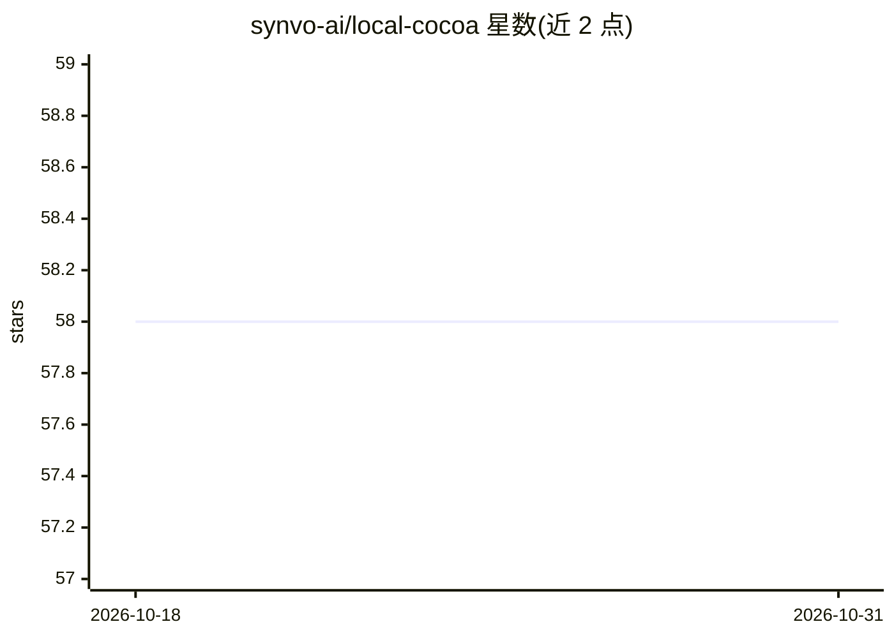

# synvo-ai/local-cocoa

⭐ 58 · TypeScript · MIT · 推送 2026-03-24 · [GitHub](https://github.com/synvo-ai/local-cocoa) · [官网](https://www.synvo.ai/) · 组织维护

**全本地运行的桌面 AI 助手：把你的文件变成可检索记忆**

面向个人用户的桌面端 AI 助手应用，推理、索引与检索全部在本机运行，无数据外发。核心机制：将文档、图片、音频、视频转为持久化语义记忆空间，通过本地 Qdrant 向量检索与语义重排提供文件问答；内置 OCR 与 VLM 理解截图和 PDF，支持文件夹监控增量索引与自动同步。技术栈为 Electron+React 前端、FastAPI 后端、llama.cpp/whisper.cpp 运行时。限制：需从源码构建（Node.js、Python、CMake），llama server 与 whisper server 需自行编译；语音模式、插件生态等仍在开发中。

## 筛选速览

| 维度 | 判定 | 备注 |
|---|---|---|
| AI 角色 | `ai-native` | 本体是模型或模型工具 |
| 许可风险 | `permissive` | MIT |
| 部署形态 | `desktop` | 安装包/桌面程序 |
| 模型依赖 | — | README 未给出锁定关系 |
| 硬件要求 | — | 无带数字的原话,不猜 |
| 安装摩擦 | `low` | 无编译、无系统依赖或容器化 |
| 成熟度 | — | 结构信号不足 |

## 能力要点

- 全本地推理/索引/检索，零数据外发
- 多模态文件转为持久语义记忆空间，支持本地 Qdrant 向量检索与语义重排
- 集成 OCR 与 VLM，从截图和 PDF 提取文本与含义
- llama.cpp 引擎针对 Apple Silicon 与消费级 GPU 优化

## 适用场景

- 与本地文件对话，即时检索个人资料
- 扫描全年文件生成年度报告
- 把笔记纳入语义记忆供日后召回

## 场景标签

`AI 助手` `文档问答` · 领域:对话与助手

## 证据(README 行号)

> L3: # 🍫 Local Cocoa: Your Personal Cowork, Fully Local 💻
> L35: - **🧠 Multimodal Memory**: Turns documents, images, audio, and video into a persistent semantic memory space.
> L36: - **🔍 Vector-Powered Retrieval**: Local Qdrant search with semantic reranking for precise, high-recall answers.

## 星数曲线

2026-10-18 58 → 2026-10-31 58（+0）

---
*卡片 v1 · prompt 1.4 · 生成 2026-10-24 · 置信度 high · 依据 README sha `68376a9ed631` · [字段定义](../../DATASET.md)*
