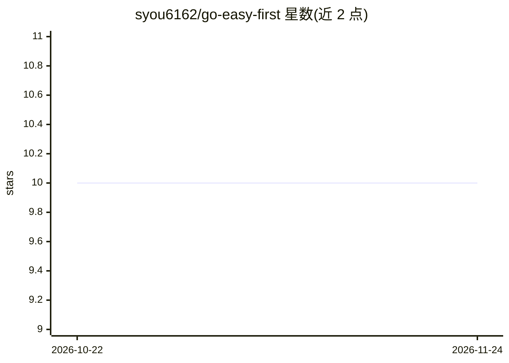

# syou6162/go-easy-first

⭐ 10 · Go · MIT · 推送 2026-10-02 · [GitHub](https://github.com/syou6162/go-easy-first) · 个人维护 · 中文 README

**面向学习者与开发者的 Java Web 脚手架模板**

这是一个基于经典 MEvn.sh 整合方案的 SpringBoot 后端脚手架模板，自称「Spring Boot 教程、技术栈示例代码」。它以四个基础表（用户/头像/角色/权限）为内置业务模型，将 JWT+Spring Security 权限集成、Swagger API 文档、WebSocket/SSE、切面日志、定时任务等技术点预先整合在一起，并附带骨架代码生成脚本、多环境打包配置和 Docker 一键部署脚本。适合想快速获得一个结构规范的后端工程起点、或想通过一个完整示例学习 Java Web 技术栈的开发者。

## 筛选速览

| 维度 | 判定 | 备注 |
|---|---|---|
| AI 角色 | `ai-knowledge` | 知识聚合/清单类 |
| 许可风险 | `permissive` | MIT |
| 部署形态 | `None` |  |
| 模型依赖 | — | README 未给出锁定关系 |
| 硬件要求 | — | 无带数字的原话,不猜 |
| 安装摩擦 | `low` | 无编译、无系统依赖或容器化 |
| 成熟度 | — | 结构信号不足 |

## 能力要点

- 内置用户/头像/角色/权限四表模型
- 提供骨架代码生成脚本
- 整合 JWT + Spring Security 权限、Swagger 文档、WebSocket/SSE、切面日志、定时任务
- 提供多环境打包配置与 Docker 一键部署脚本

## 适用场景

- 快速生成一个可直接二次开发的 SpringBoot 后端工程
- 通过完整示例学习 SpringBoot 全家桶技术栈
- 复用其权限模型与代码生成脚本搭建新项目

## 场景标签

`教程课程` · 领域:学习与行业

## 星数曲线

2026-10-22 10 → 2026-11-24 10（+0）

---
*卡片 v1 · prompt 1.4 · 生成 2026-11-19 · 置信度 low · 依据 README sha `74278e34764e` · [字段定义](../../DATASET.md)*
