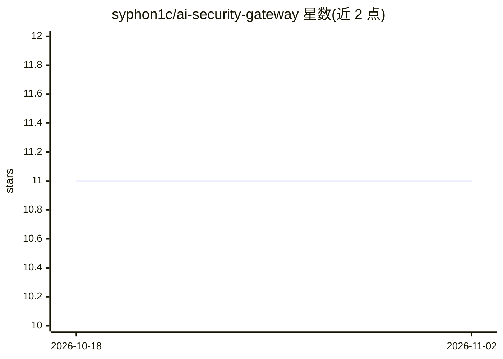

# syphon1c/ai-security-gateway

⭐ 11 · MIT · 推送 2026-08-01 · [GitHub](https://github.com/syphon1c/ai-security-gateway) · [官网](https://aisecgateway.com/) · 个人维护

**面向 LLM API/MCP/A2A 的安全网关：监控、策略执行与威胁检测**

自托管的安全代理层，部署在应用与 AI 服务之间，对 LLM API、MCP 服务器和 A2A Registry 的交互提供实时监控、策略执行与威胁检测。关键机制包括：MCP 2026-07-28 与旧版协议的双时代感知代理、基于 SPIFFE/DID/X.509 的密码学 Agent 身份验证、影子 AI 发现与 AI 资产清单（含隔离/封禁执行）、Agentic Resource Discovery 目录发布与检索 API。v2026.8.1 为首个正式版，关注企业就绪与认证会话加固；新控件默认 opt-in，缺失默认密钥时拒绝启动。

## 筛选速览

| 维度 | 判定 | 备注 |
|---|---|---|
| AI 角色 | `ai-ecosystem` | LLM/agent 周边工具 |
| 许可风险 | `permissive` | MIT |
| 部署形态 | `desktop` | 安装包/桌面程序 |
| 模型依赖 | — | README 未给出锁定关系 |
| 硬件要求 | — | 无带数字的原话,不猜 |
| 安装摩擦 | `low` | 无编译、无系统依赖或容器化 |
| 成熟度 | — | 结构信号不足 |

## 能力要点

- MCP 新旧双协议时代的感知代理与兼容桥接（降级告警）
- SPIFFE JWT/X.509-SVID 与 did:key/did:web 的 Agent 身份验证、DPoP 证明校验
- 影子 AI 资产清单与代理层隔离/封禁执行
- ARD 目录发布（ai-catalog.json）与自然语言检索 API

## 适用场景

- 在企业内对 LLM 与 MCP 流量做统一安全代理与审计
- 发现并封禁未经批准的影子 AI 使用
- 为 Agent 工作负载做密码学身份验证与委托链核验

## 场景标签

`网络安全` · 领域:学习与行业

## 证据(README 行号)

> L10: The **AI Security Gateway** is a unified security platform that provides **real-time monitoring**, **policy enforce
> L6: > **🚀 First Full Release** - A security gateway and monitoring platform for LLM APIs, Model Context Protocol (MCP) s

## 星数曲线

2026-10-18 11 → 2026-11-02 11（+0）

---
*卡片 v1 · prompt 1.4 · 生成 2026-11-01 · 置信度 mid · 依据 README sha `9f71702843e3` · [字段定义](../../DATASET.md)*
