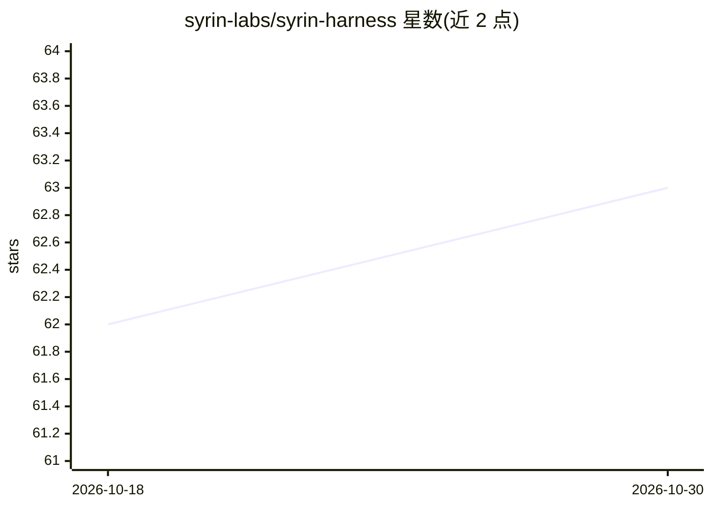

# syrin-labs/syrin-harness

⭐ 63 · Python · MIT · 推送 2026-05-18 · [GitHub](https://github.com/syrin-labs/syrin-harness) · [官网](https://docs.syrin.dev/agent-kit) · 组织维护

**Python AI Harness 框架：为 LLM 应用提供预算、内存、沙箱等生产层**

面向 Python 开发者的 LLM 生产框架：以单个 Agent 类封装任意 LLM（OpenAI/Anthropic/Google/Ollama 或自定义），在每次调用前执行硬预算与速率窗口约束；提供四类持久内存与可切换后端、子进程隔离的代码沙箱、五种拓扑的多智能体 Swarm 编排、72+ 类型化生命周期钩子、PII/内容/提示注入等护栏，以及一行 serve 的 HTTP 服务与检查点崩溃恢复。pip 安装，PROCESS 沙箱后端零外部依赖；README 含 v0.11→v0.12 迁移指南说明存在破坏性变更。

## 筛选速览

| 维度 | 判定 | 备注 |
|---|---|---|
| AI 角色 | `ai-ecosystem` | LLM/agent 周边工具 |
| 许可风险 | `permissive` | MIT |
| 部署形态 | `library` | 以包/库形式分发 |
| 模型依赖 | — | README 未给出锁定关系 |
| 硬件要求 | — | 无带数字的原话,不猜 |
| 安装摩擦 | `low` | 无编译、无系统依赖或容器化 |
| 成熟度 | — | 结构信号不足 |

## 能力要点

- 调用前+调用后的硬预算运行时约束与共享预算池
- 子进程隔离的 Python/bash 沙箱执行（PROCESS 后端零依赖）
- 五种拓扑的 Swarm 多智能体编排与递归子代理生成
- 72+ 类型化生命周期钩子与一行启用全量 tracing

## 适用场景

- 给 LLM agent 加硬成本上限，防止失控账单
- 在隔离沙箱中执行 LLM 生成的代码
- 构建带持久记忆的多智能体系统
- 快速将 agent 以 HTTP API 形式提供服务

## 场景标签

`Agent 框架` `多智能体` `Agent 记忆` · 领域:Agent 开发

## 证据(README 行号)

> L5:  Wrap any LLM with budget control, memory, observability, sandboxed execution,
> L26: **Syrin is the harness.** It wraps any LLM — OpenAI, Anthropic, Google, Ollama, or your own — with everything a Pyt

## 星数曲线

2026-10-18 62 → 2026-10-30 63（+1）

---
*卡片 v1 · prompt 1.4 · 生成 2026-10-24 · 置信度 high · 依据 README sha `ca497f008517` · [字段定义](../../DATASET.md)*
