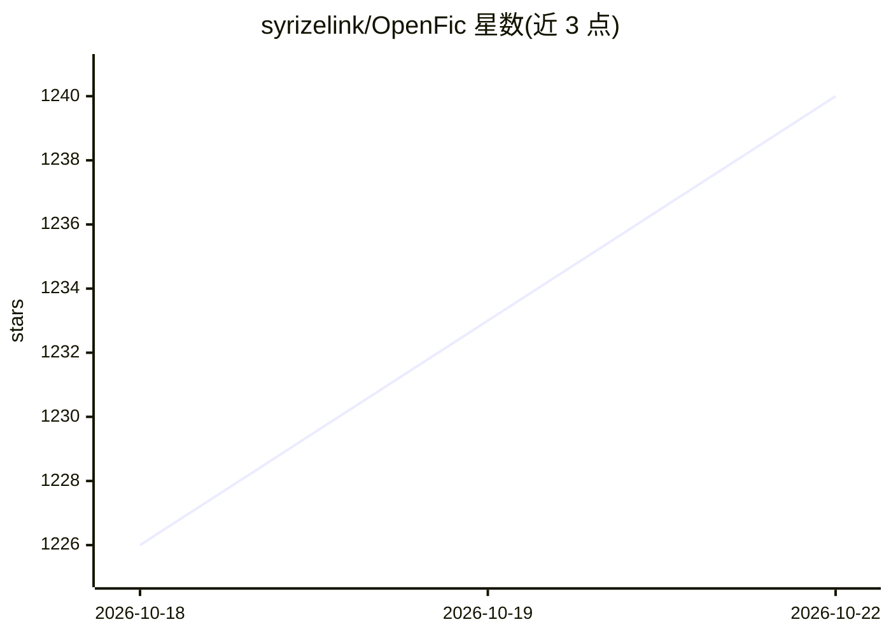

# syrizelink/OpenFic

⭐ 1,240 · Python · Apache-2.0 · 推送 2026-10-21 · [GitHub](https://github.com/syrizelink/OpenFic) · 组织维护 · 中文 README

**面向小说创作的 AI Native 一站式 Vibe Writing 工具**

跨平台小说写作工具，用户构建设定、角色与工作流，由可配置的 Agent 系统（可修改 Prompt、自定义 Agent 与工作流）深度参与创作过程。支持多种提供商模型及任何兼容 OpenAI API 的模型；提供基于向量的 Agentic RAG 在百万字级项目中检索过往信息，多层上下文管理（压缩、截断、缓存）控制成本，所有项目数据本地保存。安装方式含 Docker、pip（需 Python3.12+）与桌面版。README 明确说明不定位为一键生成整本小说。

## 筛选速览

| 维度 | 判定 | 备注 |
|---|---|---|
| AI 角色 | `ai-native` | 本体是模型或模型工具 |
| 许可风险 | `permissive` | Apache-2.0 |
| 部署形态 | `desktop` | 安装包/桌面程序 |
| 模型依赖 | — | README 未给出锁定关系 |
| 硬件要求 | — | 无带数字的原话,不猜 |
| 安装摩擦 | `low` | 无编译、无系统依赖或容器化 |
| 成熟度 | — | 结构信号不足 |

## 能力要点

- 高度可配置的 Agent 系统：自由修改 Prompt、构建自定义工作流
- 基于向量的 Agentic RAG，支持百万字级项目内语义检索
- 多层上下文管理：智能压缩、动态截断、稳定缓存
- 本地持久化存储，零云存储依赖

## 适用场景

- 写中长篇小说时长期维护世界观、角色、伏笔与章节信息
- 让 Agent 协助发散思路、检查前后文、补全细节
- 按自己的流程定制 Prompt、Agent 和工作流进行协同创作

## 场景标签

 · 领域:创意写作/AI 工具

## 证据(README 行号)

> L15: **OpenFic** 是一款专为小说创作打造的跨平台、用户友好、AI Native 的一站式 Vibe Writing 工具，构建设定、设计角色、定制工作流，让Agent适应你的写作流程，而非反之。
> L59: - 🤖**人机协同创作**：与 Agent 深度集成的辅助创作，发散思维、构建情节、协同编辑，而非抽卡式的一键生成

## 星数曲线

2026-10-18 1,226 → 2026-10-22 1,240（+14）

---
*卡片 v1 · prompt 1.4 · 生成 2026-10-21 · 置信度 high · 依据 README sha `0ea8067efd99` · [字段定义](../../DATASET.md)*
