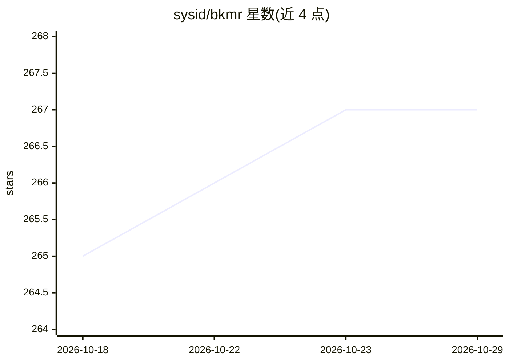

# sysid/bkmr

⭐ 267 · Rust · BSD-3-Clause · 推送 2026-10-09 · [GitHub](https://github.com/sysid/bkmr) · 个人维护

**本地优先的 CLI 知识管理工具：存储书签/片段/记忆并按语义检索**

Rust 编写的命令行知识管理工具，存储 URL、代码片段、shell 命令、Markdown、环境变量等多种内容类型，并提供基于内容类型的动作分发（浏览器打开、剪贴板复制、交互执行等）。支持全文检索、基于本地嵌入的语义检索（fastembed，离线无需 API key）与 RRF 融合的混合检索。面向开发者与 AI agent：JSON 输出、非交互模式、`_mem_` 系统标签与 hsearch 构成 agent 长期记忆的读写接口；另内置 LSP 服务器将片段注入编辑器补全。通过 cargo 安装，数据全部本地存储。

## 筛选速览

| 维度 | 判定 | 备注 |
|---|---|---|
| AI 角色 | `ai-enhanced` | 去掉 AI 部分产品仍成立 |
| 许可风险 | `permissive` | BSD-3-Clause |
| 部署形态 | `library` | 以包/库形式分发 |
| 模型依赖 | — | README 未给出锁定关系 |
| 硬件要求 | — | 无带数字的原话,不猜 |
| 安装摩擦 | `medium` | 含编译或系统依赖之一 |
| 成熟度 | — | 结构信号不足 |

## 能力要点

- 多内容类型存储与基于类型的动作分发（URL/片段/脚本/Markdown/env）
- 全文 + 语义 + RRF 混合检索，本地嵌入离线运行
- `_mem_` 系统标签与 JSON 输出构成 AI agent 记忆读写接口
- 内置 LSP 服务器与 Neovim/IntelliJ 编辑器插件集成

## 适用场景

- 在终端统一管理书签、代码片段和 shell 命令并快速调用
- 为 AI agent 提供持久化长期记忆存储
- 在编辑器内补全和复用已存的代码片段

## 场景标签

`Agent 记忆` `知识库管理` `语义搜索` · 领域:Agent 开发

## 证据(README 行号)

> L14: **Organize**, **find**, and **apply** various content types:
> L26: - **Agent-friendly**: JSON output, non-interactive mode, and `_mem_` system tag for AI agent memory
> L34: ## Agent Memory and Skill

## 星数曲线

2026-10-18 265 → 2026-10-29 267（+2）

---
*卡片 v1 · prompt 1.4 · 生成 2026-10-22 · 置信度 high · 依据 README sha `938941f713ab` · [字段定义](../../DATASET.md)*
