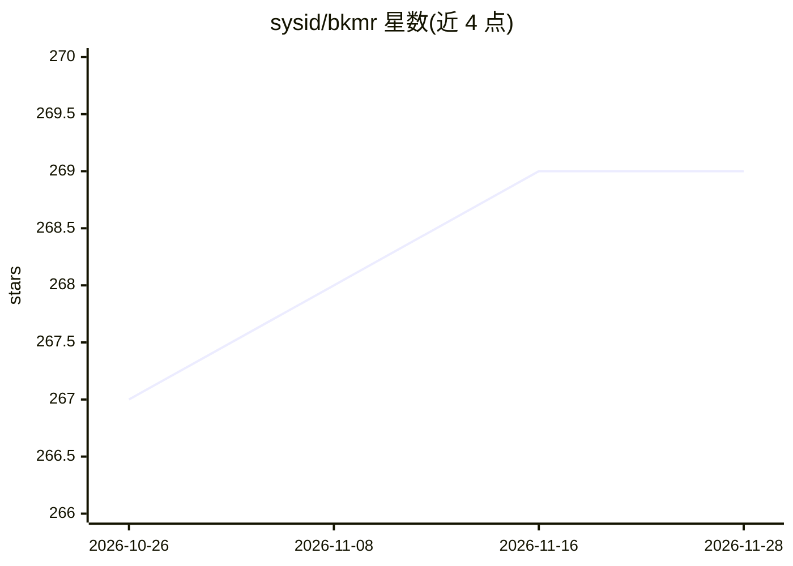

# sysid/bkmr

⭐ 269 · Rust · BSD-3-Clause · 推送 2026-11-27 · [GitHub](https://github.com/sysid/bkmr) · 个人维护

**本地优先的知识管理 CLI：为人和 AI agent 存储与语义检索内容**

Rust 编写的 CLI 工具，将 URL 书签、代码片段、shell 命令、Markdown、环境变量和纯文本统一存入本地 SQLite 库，按内容类型分发动作（打开浏览器、复制剪贴板、执行脚本等）。检索层提供 FZF 模糊搜索与 FTS+语义混合搜索，嵌入在本地 ONNX 上离线运行，无 API key。通过 _mem_ 系统标签与 hsearch 为 AI agent 提供持久化读写记忆接口，并可将 bkmr-memory 技能安装到 agent 的 skills 目录；内置 LSP 服务器支持编辑器补全，配 Neovim 与 IntelliJ 插件。

## 筛选速览

| 维度 | 判定 | 备注 |
|---|---|---|
| AI 角色 | `ai-enhanced` | 去掉 AI 部分产品仍成立 |
| 许可风险 | `permissive` | BSD-3-Clause |
| 部署形态 | `library` | 以包/库形式分发 |
| 模型依赖 | — | README 未给出锁定关系 |
| 硬件要求 | — | 无带数字的原话,不猜 |
| 安装摩擦 | `medium` | 含编译或系统依赖之一 |
| 成熟度 | — | 结构信号不足 |

## 能力要点

- 混合搜索（FTS+语义，RRF 融合），本地嵌入离线运行
- _mem_ 系统标签与 hsearch 构成 agent 读写记忆接口
- bkmr-memory 技能可安装至 Claude Code 等 agent skills 目录
- 内置 LSP 服务器，兼容 VS Code/Vim/Emacs 与 JetBrains 插件

## 适用场景

- 把生产环境配置、事实信息作为 agent 的长期记忆存取
- 统一管理书签、代码片段和 shell 命令并快速检索
- 在编辑器内通过 LSP 补全直接调用代码片段
- 用 JSON 导出做书签备份与选择性恢复

## 场景标签

`Agent 记忆` `知识库管理` `语义搜索` · 领域:Agent 开发

## 证据(README 行号)

> L26: - **Agent-friendly**: JSON output, non-interactive mode, and `_mem_` system tag for AI agent memory
> L29: - **Privacy-focused**: Fully local — database, embeddings, and search all run offline
> L36: Persistent long-term memory for AI agents. The `_mem_` system tag and `hsearch` (hybrid FTS + semantic search) crea

## 星数曲线

2026-10-26 267 → 2026-11-28 269（+2）

---
*卡片 v1 · prompt 1.4 · 生成 2026-11-28 · 置信度 high · 依据 README sha `fd3b145080fc` · [字段定义](../../DATASET.md)*
