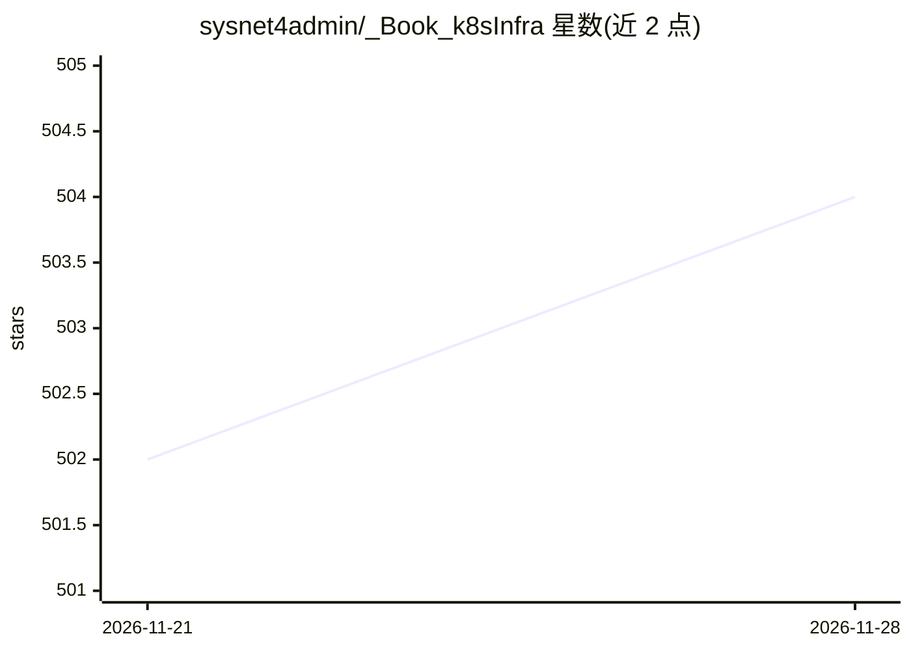

# sysnet4admin/_Book_k8sInfra

⭐ 504 · Shell · 推送 2026-11-26 · [GitHub](https://github.com/sysnet4admin/_Book_k8sInfra) · [官网](https://product.kyobobook.co.kr/detail/S000221973541) · 组织维护

**韩国 Kubernetes/Docker 图书配套的动手实验代码库**

韩国图书《요즘 개발자를 위한 쿠버네티스/도커》的配套实践代码库：提供各章节的实验文件，包括用 Vagrant 构建虚拟机、部署 Kubernetes 集群、Docker/Harbor 镜像构建、Jenkins CI/CD、Prometheus/Grafana 监控套件，第 7 章涵盖 Operator 模式、OpenTelemetry、Argo CD/Rollouts 与小型 LLM。同时提供 OVA 虚拟机镜像（arm64/x86）供跳过 Vagrant 直接搭建实验环境，并附勘误表、参考文档与安装问题说明。面向购买该书并跟随实验的开发者。

## 筛选速览

| 维度 | 判定 | 备注 |
|---|---|---|
| AI 角色 | `ai-knowledge` | 知识聚合/清单类 |
| 许可风险 | `none` | — |
| 部署形态 | `None` |  |
| 模型依赖 | — | README 未给出锁定关系 |
| 硬件要求 | — | 无带数字的原话,不猜 |
| 安装摩擦 | `low` | 无编译、无系统依赖或容器化 |
| 成熟度 | — | 结构信号不足 |

## 能力要点

- 提供按章节组织的 Kubernetes/Docker 实验代码与配置文件
- 提供 VirtualBox OVA 镜像（arm64/x86）替代 Vagrant 搭建 4 节点集群
- 第 7 章含 Argo CD/Rollouts、Cilium、OpenTelemetry 与小型 LLM 实验
- 附勘误表、kubespray 多控制面附录与参考文档

## 适用场景

- 跟随图书章节搭建本地 Kubernetes 实验环境
- 用 OVA 镜像跳过 Vagrant 安装问题直接获得集群
- 学习 GitOps、监控栈与网络策略的动手实验

## 场景标签

`教程课程` · 领域:学习与行业

## 证据(README 行号)

> L23: 이 저장소는 요즘 개발자를 위한 쿠버네티스/도커 책의 실습을 위한 코드를 제공합니다.
> L25: 베이그런트로 만든 가상 머신 위에 쿠버네티스 클러스터를 직접 구성하고, 도커와 하버, 젠킨스, 프로메테우스와 그라파나 제품군을 실습합니다. 7장에서는 오퍼레이터 패턴, 오픈텔레메트리, 아르고 CD와 아르고 

## 星数曲线

2026-11-21 502 → 2026-11-28 504（+2）

---
*卡片 v1 · prompt 1.4 · 生成 2026-11-27 · 置信度 high · 依据 README sha `1df45f8c7283` · [字段定义](../../DATASET.md)*
