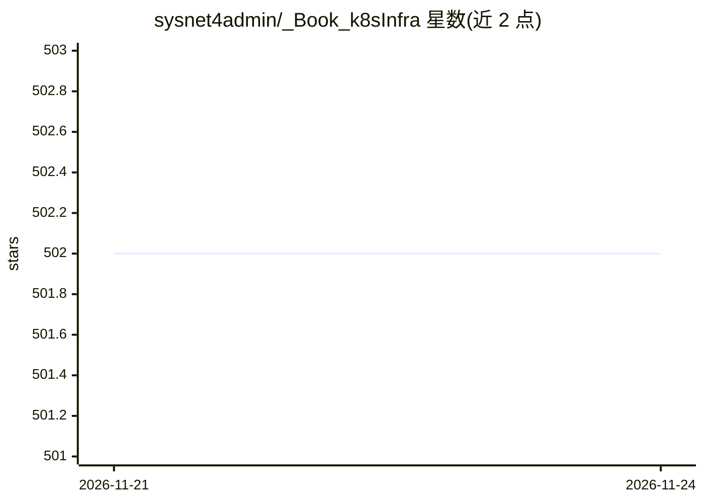

# sysnet4admin/_Book_k8sInfra

⭐ 502 · Shell · 推送 2026-11-21 · [GitHub](https://github.com/sysnet4admin/_Book_k8sInfra) · [官网](https://product.kyobobook.co.kr/detail/S000221973541) · 组织维护

**韩国 Kubernetes/Docker 图书的配套实验代码仓库**

韩国 Gilbut 出版社《요즘 개발자를 위한 쿠버네티스/도커》一书的官方配套仓库，提供各章实验代码：第 2 章用 Vagrant/VirtualBox 搭建测试虚拟机，第 3-6 章覆盖 Kubernetes 集群、Docker 与 Harbor 镜像构建、Jenkins CI/CD、Prometheus/Grafana 监控栈，第 7 章涉及 Operator、OpenTelemetry、Argo CD/Rollouts、Cilium 及小型 LLM 实验。附勘误表、参考文档、OVA 镜像（标注准备中）与教学视频链接。

## 筛选速览

| 维度 | 判定 | 备注 |
|---|---|---|
| AI 角色 | `ai-knowledge` | 知识聚合/清单类 |
| 许可风险 | `none` | — |
| 部署形态 | `None` |  |
| 模型依赖 | — | README 未给出锁定关系 |
| 硬件要求 | — | 无带数字的原话,不猜 |
| 安装摩擦 | `low` | 无编译、无系统依赖或容器化 |
| 成熟度 | — | 结构信号不足 |

## 能力要点

- 按章节组织的 Kubernetes/Docker 实验代码与 Vagrantfile
- 提供 GitOps、Argo Rollouts 蓝绿部署等进阶实验
- 为 Vagrant 安装困难用户提供 OVA 镜像方案（标注准备中）
- 提供勘误表、参考文档与终端工具配置视频

## 适用场景

- 跟随该书章节搭建 Kubernetes 学习环境
- 复现 GitOps 与 CI/CD 流水线实验
- 查询书中内容的勘误与补充说明

## 场景标签

`教程课程` · 领域:学习与行业

## 证据(README 行号)

> L23: 이 저장소는 요즘 개발자를 위한 쿠버네티스/도커 책의 실습을 위한 코드를 제공합니다.
> L25: 베이그런트로 만든 가상 머신 위에 쿠버네티스 클러스터를 직접 구성하고, 도커와 하버, 젠킨스, 프로메테우스와 그라파나 제품군을 실습합니다. 7장에서는 오퍼레이터 패턴, 오픈텔레메트리, 아르고 CD와 아르고 

## 星数曲线

2026-11-21 502 → 2026-11-24 502（+0）

---
*卡片 v1 · prompt 1.4 · 生成 2026-11-21 · 置信度 high · 依据 README sha `63e8b4a897a6` · [字段定义](../../DATASET.md)*
