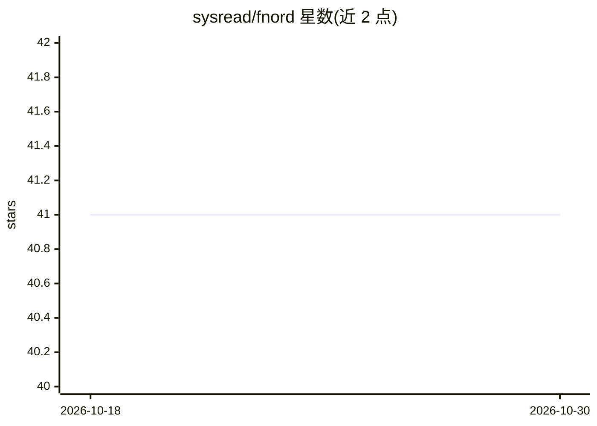

# sysread/fnord

⭐ 41 · Elixir · MIT · 推送 2026-09-22 · [GitHub](https://github.com/sysread/fnord) · 个人维护

**对代码库做索引与问答的 LLM 命令行工具**

Elixir 编写的 escript 命令行工具，用多个 LLM 驱动的 agent 与工具调用提供针对代码库、笔记与文本文件的对话接口。机制：用 OpenAI text-embedding-3-large 生成嵌入索引（含文件摘要、函数/符号索引与提交历史索引），通过多 agent 分工将文件细节移出协调 agent 的上下文窗口；支持语义搜索、按需生成文档、git 历史查询、项目知识积累与 MCP server。需设置 OpenAI API key；README 声明已停止积极开发，后继项目为 thatch（opencode 插件）。

## 筛选速览

| 维度 | 判定 | 备注 |
|---|---|---|
| AI 角色 | `ai-native` | 本体是模型或模型工具 |
| 许可风险 | `permissive` | MIT |
| 部署形态 | `None` |  |
| 模型依赖 | — | README 未给出锁定关系 |
| 硬件要求 | — | 无带数字的原话,不猜 |
| 安装摩擦 | `low` | 无编译、无系统依赖或容器化 |
| 成熟度 | — | 结构信号不足 |

## 能力要点

- 多 agent 工具调用架构，避免整文件进入协调 agent 上下文窗口
- 索引过程生成文件摘要与函数/实体/符号索引以增强语义匹配
- 提交历史索引与 git 历史语义查询
- 持久化项目记忆与学习，后续会话可复用先前研究成果

## 适用场景

- 对自己的项目提问，定位函数定义、调用方与单元测试
- 按需生成项目教程、playbook 与文档
- 检索仓库提交历史回答代码演变问题

## 场景标签

`语义搜索` `文档问答` · 领域:知识与检索

## 证据(README 行号)

> L13: `fnord` is a command line tool that uses multiple LLM-powered agents and tools to provide a conversational interfac
> L23: `fnord` attempts to mitigate this with cleverly designed tool calls that allow the LLM to ask _other_ agents to per

## 星数曲线

2026-10-18 41 → 2026-10-30 41（+0）

---
*卡片 v1 · prompt 1.4 · 生成 2026-10-25 · 置信度 high · 依据 README sha `b5bca259b2c2` · [字段定义](../../DATASET.md)*
