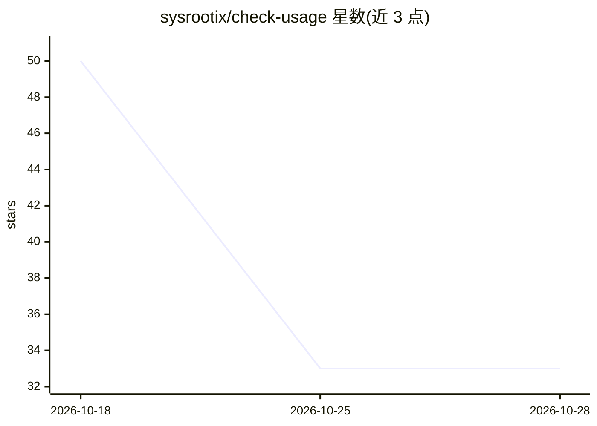

# sysrootix/check-usage

⭐ 33 · Swift · MIT · 推送 2026-09-16 · [GitHub](https://github.com/sysrootix/check-usage) · [官网](https://github.com/sysrootix/check-usage) · 个人维护 · 中文 README

**macOS 菜单栏/屏幕边缘小组件：集中显示各 AI 工具剩余用量**

Swift 6 原生 macOS 应用（需 macOS 14+），在菜单栏与屏幕边缘以圆环形式显示 Claude、Cursor、Codex、Copilot、Gemini、Grok 等 11 个 AI 编程工具的剩余配额、重置时间与花费进度预测。复用官方 CLI/应用在本机已有的登录会话（Keychain、auth.json），无需额外登录；OpenRouter/DeepSeek/Z.ai 通过 API key 接入。多数用量端点为非官方接口，可能随时变更。提供 GitHub Release 安装包与源码构建两种方式，无遥测。

## 筛选速览

| 维度 | 判定 | 备注 |
|---|---|---|
| AI 角色 | `ai-ecosystem` | LLM/agent 周边工具 |
| 许可风险 | `permissive` | MIT |
| 部署形态 | `desktop` | 安装包/桌面程序 |
| 模型依赖 | locked-api |  |
| 硬件要求 | — | 无带数字的原话,不猜 |
| 安装摩擦 | `low` | 无编译、无系统依赖或容器化 |
| 成熟度 | — | 结构信号不足 |

## 能力要点

- 复用官方 CLI/应用已有登录会话，无需额外登录
- 支持 11 个 AI 工具的配额读取（Claude/Cursor/Codex/Copilot/Gemini/Grok 等）
- 花费进度卡：周期进度、按当前速率的额度耗尽日期预测
- 70%/90% 可选通知，令牌不出本机（除所属服务商），无遥测

## 适用场景

- 在一台 Mac 上运行多个 AI 编程工具时，随时查看各工具剩余额度
- 避免请求失败后才发现额度用尽
- 为 OpenRouter/DeepSeek 等 API key 余额做桌面端监控

## 场景标签

`LLM 可观测性` · 领域:评测与运维

## 证据(README 行号)

> L11: Usage limits for the AI tools already signed in on your Mac — a slim **edge pill** with circular rings, plus a deta
> L31: |Provider|Source of truth|Sign-in it reuses|
> L33: |Claude|`GET /api/oauth/usage`|Claude Code Keychain|

## 星数曲线

2026-10-18 50 → 2026-10-28 33（-17）

---
*卡片 v1 · prompt 1.4 · 生成 2026-10-25 · 置信度 high · 依据 README sha `4742ef6e4264` · [字段定义](../../DATASET.md)*
