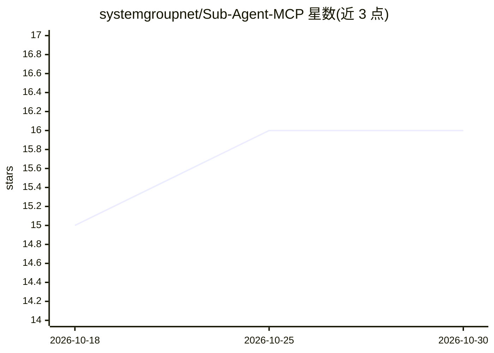

# systemgroupnet/Sub-Agent-MCP

⭐ 16 · Python · Apache-2.0 · 推送 2026-06-09 · [GitHub](https://github.com/systemgroupnet/Sub-Agent-MCP) · 组织维护

**让父 LLM 通过 MCP 委派任务给多个 YAML 定义子代理的服务器**

Python 实现的 MCP 服务器，位于父 LLM（如 Cursor 的 agent）与多个专职子代理之间：每个在 agents.yaml 中定义的代理（含各自 LLM、系统提示词、下游 MCP 工具与白名单）在启动时注册为同名 MCP 工具，父代理以 prompt 参数调用即得到该子代理的最终回复。子代理基于 LangChain 1.x 与 OpenAI 兼容模型构建，传输仅支持 Streamable HTTP，配置经 Pydantic 校验并支持环境变量替换。提供 Docker Compose、本地 Python 与 GHCR 镜像三种运行方式，面向需要代理委派架构的开发者。

## 筛选速览

| 维度 | 判定 | 备注 |
|---|---|---|
| AI 角色 | `ai-ecosystem` | LLM/agent 周边工具 |
| 许可风险 | `permissive` | Apache-2.0 |
| 部署形态 | `self-host` | docker 或自建部署 |
| 模型依赖 | local-ok | 支持本地模型 |
| 硬件要求 | — | 无带数字的原话,不猜 |
| 安装摩擦 | `low` | 无编译、无系统依赖或容器化 |
| 成熟度 | — | 结构信号不足 |

## 能力要点

- 每个 YAML 定义的子代理注册为一个 MCP 工具，父代理按 id 调用
- 子代理可配置独立 LLM、系统提示词、下游 MCP 服务器与工具白名单
- 支持任意 OpenAI 兼容提供方（OpenAI/Azure/Ollama/LM Studio 等）
- Pydantic 校验、结构化日志、Docker 健康检查与 GHCR 镜像发布

## 适用场景

- 让 Cursor 等父代理把研究、写作等任务委派给专职子代理
- 为不同角色代理配置不同模型与工具权限
- 在不撑大父代理上下文的前提下接入多个下游 MCP 工具服务器

## 场景标签

`Agent 框架` `多智能体` · 领域:Agent 开发

## 证据(README 行号)

> L8: Production-ready Python MCP server for **LLM delegation and sub-agent orchestration**. A parent LLM (for example, Cu
> L16: Sub-Agent MCP sits between a **parent LLM** and one or more **specialized sub-agents**:
> L19: 2. At startup, each agent in `agents.yaml` is registered as an MCP tool named by its `id`.

## 星数曲线

2026-10-18 15 → 2026-10-30 16（+1）

---
*卡片 v1 · prompt 1.4 · 生成 2026-10-30 · 置信度 high · 依据 README sha `baf6692292e3` · [字段定义](../../DATASET.md)*
