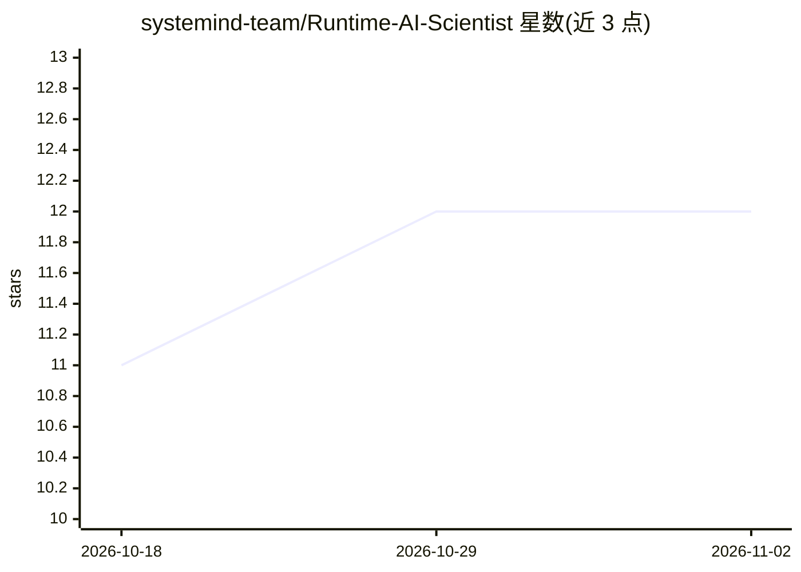

# systemind-team/Runtime-AI-Scientist

⭐ 12 · Python · MIT · 推送 2026-10-04 · [GitHub](https://github.com/systemind-team/Runtime-AI-Scientist) · [官网](https://systemind-team.github.io/Runtime-AI-Scientist/) · 组织维护 · 中文 README

**多智能体 AI 科学家的运行时协调与评测层（论文官方代码）**

论文 "Can AI Scientists Coordinate at Runtime?" 的官方代码，提出运行时智能体协调（RAC）：在每次交接时由当前智能体基于研究实时状态选择下一个智能体，可附加工作契约与基于产物的验证。以一套共享的 N0–R3 策略、runner、schema 与预算账本，不加修改地接入 ARK、Agent Laboratory、EvoScientist 三个 AI 科学家宿主，并在 ResearchClawBench 上评测。提供 rac-ai-scientist CLI（八个子命令）与 Docker Compose 运行方式；评测为单种子探索性研究（10 任务），作者明确邀请社区扩展实验。需 Linux + Docker 与 OpenAI 兼容端点。

## 筛选速览

| 维度 | 判定 | 备注 |
|---|---|---|
| AI 角色 | `ai-ecosystem` | LLM/agent 周边工具 |
| 许可风险 | `permissive` | MIT |
| 部署形态 | `self-host` | docker 或自建部署 |
| 模型依赖 | locked-api |  |
| 硬件要求 | — | 无带数字的原话,不猜 |
| 安装摩擦 | `low` | 无编译、无系统依赖或容器化 |
| 成熟度 | `idea` | |

## 能力要点

- RAC：交接时由当前智能体基于实时研究状态选择下一智能体
- 同一 N0–R3 策略接入 ARK / Agent Laboratory / EvoScientist 三个宿主
- CLI 含 doctor/plan/run-one/score-episode 等八个子命令，多数无需模型调用
- 上游项目经 upstream.lock.json 精确固定，评分在独立 scorer 镜像中进行

## 适用场景

- 复现论文中 N0–R3 条件对比实验
- 为多智能体 AI 科学家的协调机制做受控评测
- 参与作者列出的开放实验（更多种子/任务/模型）

## 场景标签

`多智能体` `模型评测` · 领域:Agent 开发

## 证据(README 行号)

> L20: **Runtime AI Scientist** is the official code for our paper **Can AI Scientists Coordinate at Runtime?** It introdu
> L22: This repository is the integration and evaluation layer behind the paper: one shared N0–R3 policy, runner, schema s
> L81: - **Offline development and tests:** Python 3.10 or newer. No model calls, credentials, or upstream checkouts are n

## 星数曲线

2026-10-18 11 → 2026-11-02 12（+1）

---
*卡片 v1 · prompt 1.4 · 生成 2026-10-31 · 置信度 high · 依据 README sha `d6585d2608b2` · [字段定义](../../DATASET.md)*
