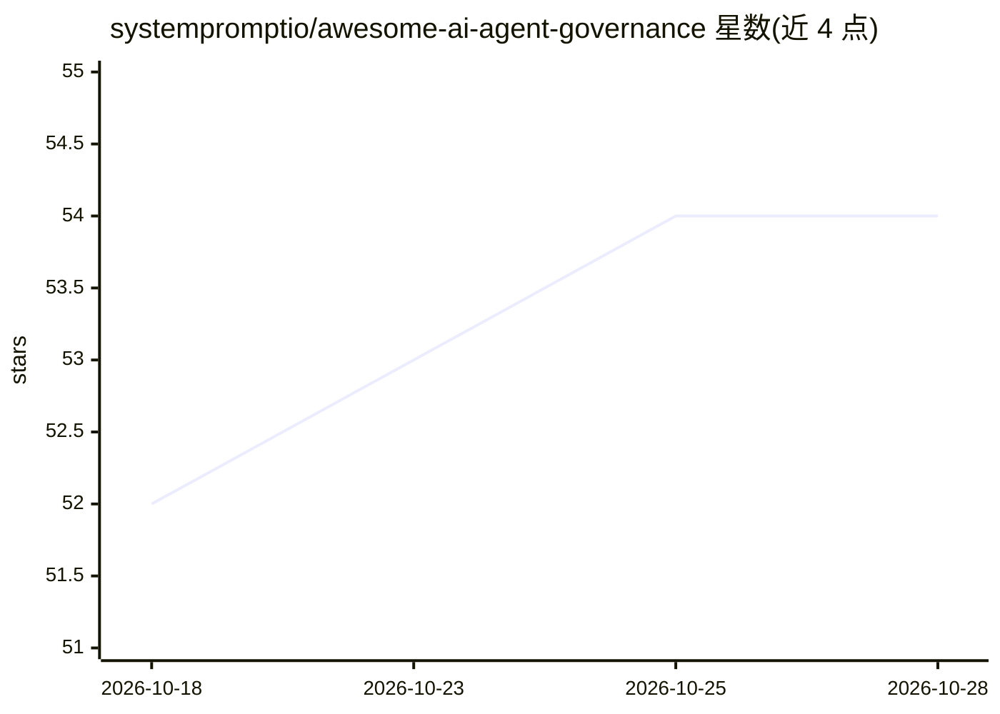

# systempromptio/awesome-ai-agent-governance

⭐ 54 · NOASSERTION · 推送 2026-10-27 · [GitHub](https://github.com/systempromptio/awesome-ai-agent-governance) · [官网](https://systemprompt.io) · 组织维护

**面向生产环境 AI agent 治理的工具、标准与资源策展清单**

策展型 awesome 清单，收录治理 AI agent 所需的国际标准（ISO/IEC 23053/42001 等）、监管框架（EU AI Act、NIST AI RMF）、行业指导（OWASP、MITRE ATLAS）以及开源治理工具包（策略执行、审计链、权限门控、成本控制类项目）。范围限定在运行时治理——策略执行、审计追踪、访问控制与合规工具，明确排除 AI 安全研究、对齐理论与责任 AI 伦理。面向在企业生产环境中部署 agent 的工程与合规团队。

## 筛选速览

| 维度 | 判定 | 备注 |
|---|---|---|
| AI 角色 | `ai-knowledge` | 知识聚合/清单类 |
| 许可风险 | `none` | NOASSERTION |
| 部署形态 | `self-host` | docker 或自建部署 |
| 模型依赖 | — | README 未给出锁定关系 |
| 硬件要求 | — | 无带数字的原话,不猜 |
| 安装摩擦 | `low` | 无编译、无系统依赖或容器化 |
| 成熟度 | — | 结构信号不足 |

## 能力要点

- 收录 ISO/IEC、NIST、OWASP、MITRE 等多来源治理标准与威胁模型
- 覆盖策略执行、审计追踪、最小权限、预算控制的的开源工具包条目
- 明确划定范围：仅运行时治理，不含安全研究/对齐/伦理
- 多条目附许可证与安装命令信息

## 适用场景

- 为企业 agent 部署寻找权限门控与审计类开源工具
- 查阅 EU AI Act、ISO 42001、NIST AI RMF 等合规要求
- 了解 OWASP Agentic AI Top 10 等威胁模型参考

## 场景标签

`精选清单` · 领域:学习与行业

## 证据(README 行号)

> L3: > The definitive curated list of tools, frameworks, standards, and resources for governing AI agents in production.
> L7: **Scope:** Runtime governance of AI agents — policy enforcement, audit trails, access control, cost management, comp
> L53: ## Open-Source Governance Toolkits

## 星数曲线

2026-10-18 52 → 2026-10-28 54（+2）

---
*卡片 v1 · prompt 1.4 · 生成 2026-10-24 · 置信度 mid · 依据 README sha `b86a80ee485d` · [字段定义](../../DATASET.md)*
