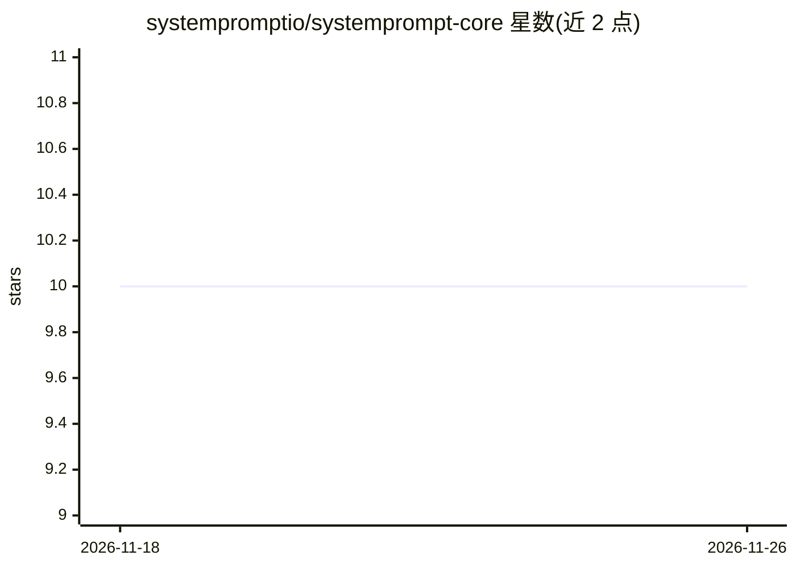

# systempromptio/systemprompt-core

⭐ 10 · Rust · NOASSERTION · 推送 2026-11-25 · [GitHub](https://github.com/systempromptio/systemprompt-core) · [官网](https://systemprompt.io) · 组织维护

**给企业 agent 系统提供身份、模型网关与审计的控制面 Rust 库**

以 Rust 库形式提供的 agent 控制面：绑定 OAuth2/OIDC 身份、提供 Anthropic 兼容的模型网关与上游路由、治理 MCP 工具调用与 A2A 传输，并把决策与推理用量记录到 PostgreSQL。行为通过编译期注册的 extension 合同扩展，YAML 配置部署。核心采用 BSL-1.1 源码可用许可，评估可用 MIT 模板，生产使用需商业许可。

## 筛选速览

| 维度 | 判定 | 备注 |
|---|---|---|
| AI 角色 | `ai-ecosystem` | LLM/agent 周边工具 |
| 许可风险 | `none` | NOASSERTION |
| 部署形态 | `library` | 以包/库形式分发 |
| 模型依赖 | — | README 未给出锁定关系 |
| 硬件要求 | — | 无带数字的原话,不猜 |
| 安装摩擦 | `low` | 无编译、无系统依赖或容器化 |
| 成熟度 | — | 结构信号不足 |

## 能力要点

- 模型网关提供 Anthropic 兼容 /v1/messages 与上游路由
- 治理式 MCP 工具访问：scope 检查、凭证模式扫描、限流与审计记录
- 通过 inventory 在编译/link 期注册 Rust 扩展（路由、providers、jobs、迁移）
- 评估用 MIT 模板含配置、admin UI 与 enforcement 演示

## 适用场景

- 为企业 agent 部署集中管理身份、模型访问与工具权限
- 记录可关联身份与决策的推理与工具调用审计
- 在私有网络/气隙环境中运行带治理的 agent 运行时

## 场景标签

`模型网关` · 领域:Agent 开发

## 证据(README 行号)

> L5: SystemPrompt Core is the Rust library for a control plane you operate: identity, model access, MCP tool execution, p
> L15: Connect supported AI clients to your gateway and expose governed MCP tools. Core binds requests to identity, evalua
> L20: |Model gateway|Anthropic-compatible `/v1/messages`, model discovery and configurable upstream routing.|

## 星数曲线

2026-11-18 10 → 2026-11-26 10（+0）

---
*卡片 v1 · prompt 1.4 · 生成 2026-11-19 · 置信度 high · 依据 README sha `d1960c6870aa` · [字段定义](../../DATASET.md)*
