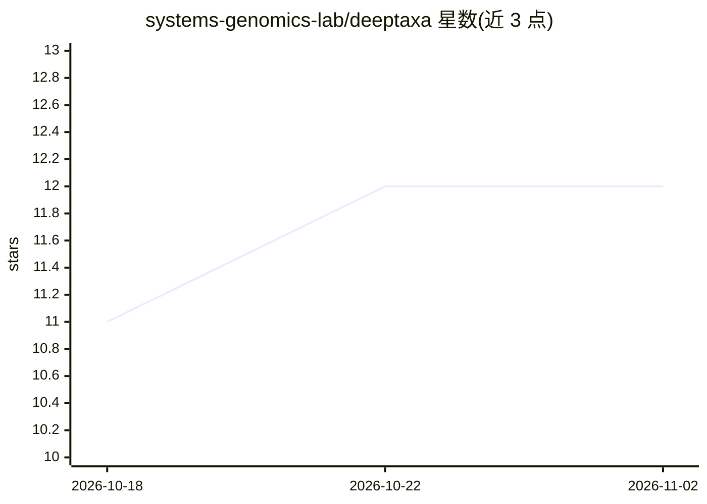

# systems-genomics-lab/deeptaxa

⭐ 12 · Python · MIT · 推送 2026-07-08 · [GitHub](https://github.com/systems-genomics-lab/deeptaxa) · [官网](https://systems-genomics-lab.github.io/deeptaxa/) · 组织维护

**面向微生物学研究者：CNN-BERT 混合模型对 16S rRNA 序列做层级物种分类**

深度学习框架 DeepTaxa，用 CNN 提取局部基序特征、BERT 提取全局上下文并融合，单次前向传播同时预测 16S rRNA 序列的全部七个分类学层级（域到种）。提供 full-length、V3-V4、V4 三个模型家族的预训练 checkpoint（Hugging Face 托管，每个区域含 5 个种子可做软投票集成），并支持训练、评估、校准分析和消融实验，附带 QIIME 2 插件。训练数据基于 Greengenes2 2024.09；GPU 需另行安装 CUDA 版 PyTorch。以 pip/conda/源码安装。

## 筛选速览

| 维度 | 判定 | 备注 |
|---|---|---|
| AI 角色 | `ai-native` | 本体是模型或模型工具 |
| 许可风险 | `permissive` | MIT |
| 部署形态 | `library` | 以包/库形式分发 |
| 模型依赖 | — | README 未给出锁定关系 |
| 硬件要求 | — | 无带数字的原话,不猜 |
| 安装摩擦 | `medium` | 含编译或系统依赖之一 |
| 成熟度 | — | 结构信号不足 |

## 能力要点

- CNN-BERT 融合架构，单次前向输出七个分类学层级
- full-length/V3-V4/V4 三个预训练模型家族，5 种子集成支持
- ECE 校准度量、编码/损失/架构消融实验与可复用脚本集
- 内置 QIIME 2 插件 q2-deeptaxa，随包安装

## 适用场景

- 我用扩增子测序数据，想直接用预训练模型预测序列的物种分类
- 我想在自有 16S 数据上训练或微调分类模型
- 我在 QIIME 2 工作流中做物种分类
- 我需要评估分类置信度的校准情况

## 场景标签

 · 领域:生物信息学/微生物组

## 证据(README 行号)

> L18: **DeepTaxa** is a deep learning framework for hierarchical taxonomic classification of 16S rRNA gene sequences. It 
> L24: The v2 full-length checkpoints achieve the following on 69,335 held-out test sequences from Greengenes2 2024.09 (5-
> L264: DeepTaxa comes with a QIIME 2 plugin (`q2-deeptaxa`) so you

## 星数曲线

2026-10-18 11 → 2026-11-02 12（+1）

---
*卡片 v1 · prompt 1.4 · 生成 2026-10-31 · 置信度 high · 依据 README sha `26af85254075` · [字段定义](../../DATASET.md)*
