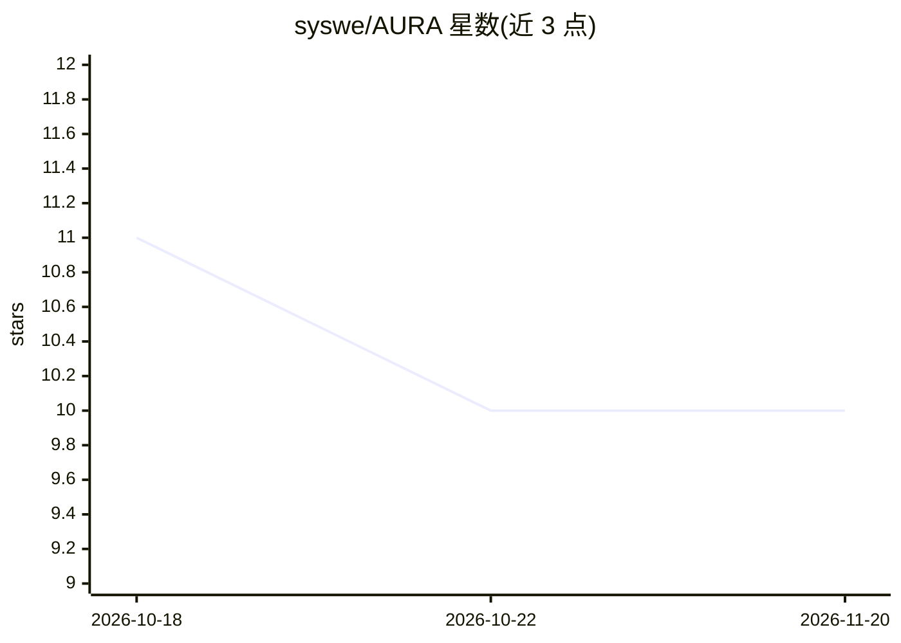

# syswe/AURA

⭐ 10 · Python · MIT · 推送 2026-07-03 · [GitHub](https://github.com/syswe/AURA) · 个人维护

**K8s 自愈系统：LLM 诊断根因，确定性门控执行修复**

面向 Kubernetes 的受限自治自愈架构：LLM 将容器日志、集群事件、Pod 状态等碎片化遥测关联为根因诊断并提出修复方案，由确定性分级执行器决定方案是否落到集群。动作全部写入 aura.audit，执行后在验证窗口复查故障指纹是否不再复现。提供命名空间白名单、参数白名单、T1-T4 风险分级（T4 恒拒绝、T3 需人工审批）、写前 server dry-run 等防护；附带 7 类故障注入场景与 4 模型基准复现工具。定位为单节点实验室集群上的研究原型。

## 筛选速览

| 维度 | 判定 | 备注 |
|---|---|---|
| AI 角色 | `ai-native` | 本体是模型或模型工具 |
| 许可风险 | `permissive` | MIT |
| 部署形态 | `None` |  |
| 模型依赖 | local-ok | 支持本地模型 |
| 硬件要求 | — | 无带数字的原话,不猜 |
| 安装摩擦 | `low` | 无编译、无系统依赖或容器化 |
| 成熟度 | `idea` | |

## 能力要点

- LLM 根因诊断 + 确定性风险分级执行门控（T1-T4）
- T3/T4 外动作升级人工审批，超出白名单范围自动拒绝
- 内置 7 个故障注入场景与冻结 golden cases 的可复现评测
- 支持 Gemini 云端或本地 Ollama 模型作为关联阶段后端

## 适用场景

- 在演示/实验集群中自动检测并修复配置错误、OOM、依赖宕机等故障
- 评估不同 LLM 在运维决策任务上的工具选择与根因判断质量
- 研究带安全门控的受限自治运维架构

## 场景标签

`模型评测` · 领域:评测与运维

## 证据(README 行号)

> L3: Bounded-autonomy self-healing for Kubernetes. An LLM correlates fragmented telemetry (container logs, cluster events
> L38: The LLM's self-reported risk assessment is ignored. The executor maps each tool to a tier deterministically and gat

## 星数曲线

2026-10-18 11 → 2026-11-20 10（-1）

---
*卡片 v1 · prompt 1.4 · 生成 2026-11-19 · 置信度 high · 依据 README sha `932ff16d427d` · [字段定义](../../DATASET.md)*
