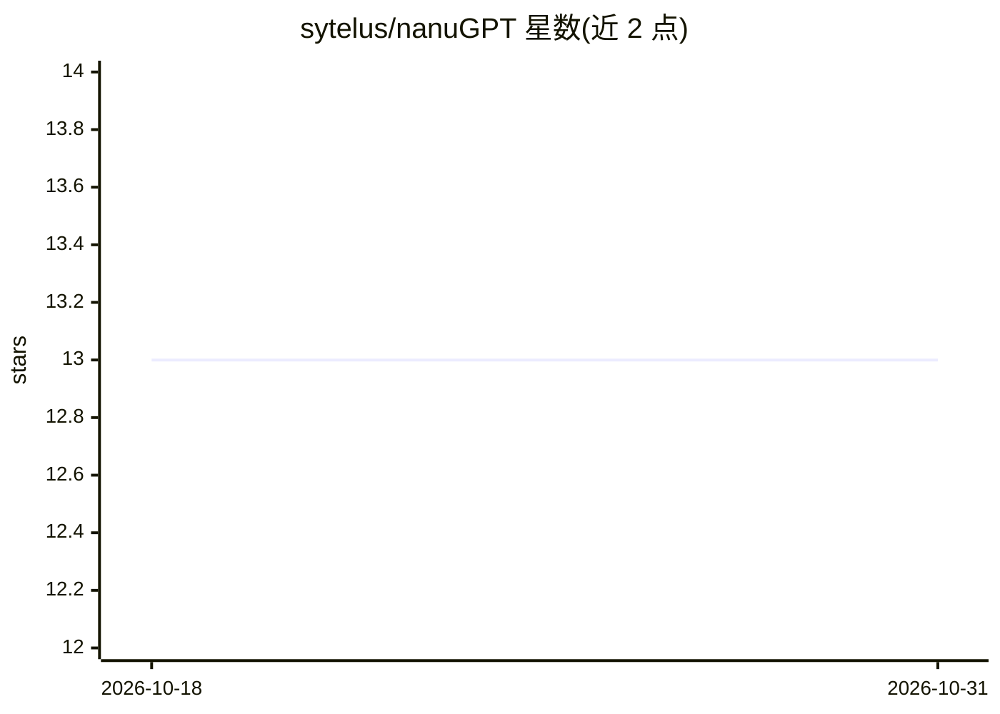

# sytelus/nanuGPT

⭐ 13 · Python · MIT · 推送 2026-06-28 · [GitHub](https://github.com/sytelus/nanuGPT) · 个人维护

**供快速实验的 Transformer 训练代码库，面向 GPU 资源有限的用户**

基于 Karpathy 的 nanoGPT 深度修改的训练代码库，保持简单可改的同时采用模块化设计：数据集、优化器、调度器、模型均可插拔，全部配置走 YAML 并支持继承与命令行覆盖。复用 PyTorch 风格组件，支持 HuggingFace 数据集与 WandB 记录。内置 TinyStories、Grokking 数据集与 llama 模型，提供单机多卡（torchrun）、Slurm、Volcano/k8s 多节点运行方式。定位为 GPU poor 用户服务，小数据集在单张 RTX 3080 上约 5-10 分钟完成实验，Grokking 实验可纯 CPU 运行。

## 筛选速览

| 维度 | 判定 | 备注 |
|---|---|---|
| AI 角色 | `ai-ecosystem` | LLM/agent 周边工具 |
| 许可风险 | `permissive` | MIT |
| 部署形态 | `library` | 以包/库形式分发 |
| 模型依赖 | — | README 未给出锁定关系 |
| 硬件要求 | — | 无带数字的原话,不猜 |
| 安装摩擦 | `low` | 无编译、无系统依赖或容器化 |
| 成熟度 | — | 结构信号不足 |

## 能力要点

- 数据集/优化器/调度器/模型可插拔的模块化设计
- YAML 配置继承与命令行覆盖
- 单机多卡、Slurm、Volcano/k8s 多节点训练支持
- TinyStories、Grokking 数据集与 llama 模型内置

## 适用场景

- 在单张消费级 GPU 上快速复现 GPT-2 规模的小实验
- 复现 Grokking 论文结果（可纯 CPU 运行）
- 在集群上做 124M 参数、最多 295B token 的训练基线

## 场景标签

`模型训练` · 领域:训练与推理

## 证据(README 行号)

> L3: This repository contains heavily modified version of Karpathy's nanoGPT. The code is kept in line with Karpathy's or
> L44: |OVERVIEW.md|Technical overview of the codebase architecture, training pipeline, distributed training, and all majo

## 星数曲线

2026-10-18 13 → 2026-10-31 13（+0）

---
*卡片 v1 · prompt 1.4 · 生成 2026-10-31 · 置信度 high · 依据 README sha `132ca1737c1a` · [字段定义](../../DATASET.md)*
