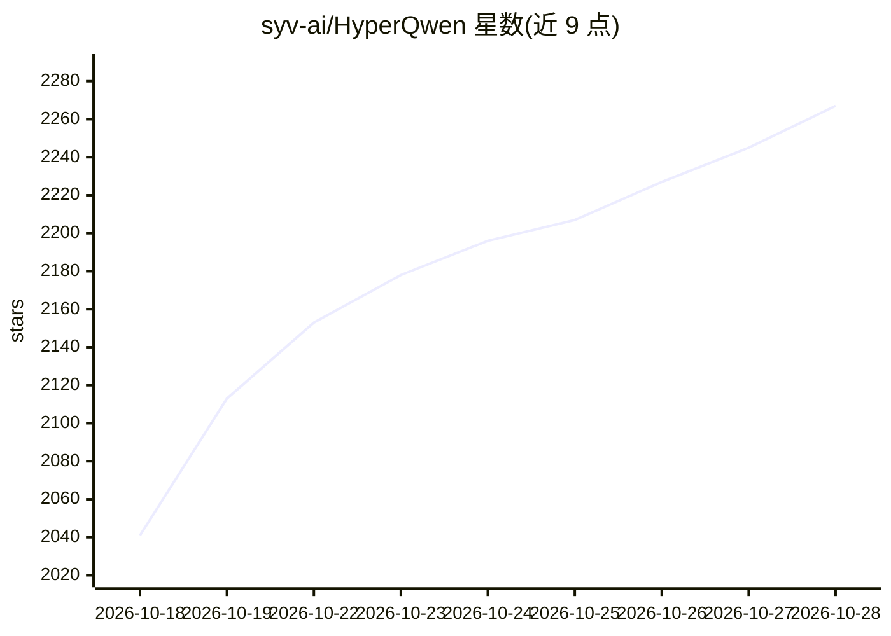

# syv-ai/HyperQwen

⭐ 2,267 · Python · Apache-2.0 · 推送 2026-10-21 · [GitHub](https://github.com/syv-ai/HyperQwen) · 组织维护

**在单张消费级 GPU 上高速部署大尺寸 Qwen 模型的 vLLM 补丁与部署套件**

面向拥有 24GB 级显卡的用户，在指定版本 vLLM 之上叠加补丁系列，配合重量化与模型准备流水线，把 Qwen3.8-27B 跑在单卡上：OpenAI 兼容 API、key 鉴权，single/batch 两种 compose 模式（127 tok/s 单流、64 并发约 1,035 tok/s、最高 240k 上下文）。核心机制含 DFlash2/MTP 投机解码、KVarN KV 缓存、int8 量化与校准草稿词表；部分内核仅适配该 checkpoint 与特定卡（sm86 实测，sm80 存在投机故障），其他显卡需按协议提交实测报告。

## 筛选速览

| 维度 | 判定 | 备注 |
|---|---|---|
| AI 角色 | `ai-ecosystem` | LLM/agent 周边工具 |
| 许可风险 | `permissive` | Apache-2.0 |
| 部署形态 | `self-host` | docker 或自建部署 |
| 模型依赖 | local-ok | 支持本地模型 |
| 硬件要求 | — | 无带数字的原话,不猜 |
| 安装摩擦 | `low` | 无编译、无系统依赖或容器化 |
| 成熟度 | `idea` | |

## 能力要点

- Qwen3.8-27B 在单张 24GB 消费卡上服务，最高 240k 上下文
- vLLM 补丁系列 + 重量化/模型准备流水线，两种 compose 模式开箱即用
- DFlash2/MTP 投机解码、KVarN 长上下文 KV 缓存、int8 量化等优化并附逐项基准
- 提供跨显卡的实测协议与复现文档体系

## 适用场景

- 在自己的一张 RTX 3090/4090 上给少数人跑本地 Qwen 聊天服务
- 作为并发 API 后端在单卡上支撑多请求流水线
- 用现成 harness 在自家显卡上提交可对比的性能实测

## 场景标签

`推理引擎` `模型量化` · 领域:训练与推理

## 证据(README 行号)

> L25: really is, under the serving setup, is a patch series against a pinned vLLM plus
> L117: **Portable already — nothing model- or card-specific in it.** The vLLM patch
> L40: docker compose --profile single up -d     # one or a few people chatting

## 星数曲线

2026-10-18 2,041 → 2026-10-28 2,267（+226）

---
*卡片 v1 · prompt 1.4 · 生成 2026-10-21 · 置信度 high · 依据 README sha `b7fb55f23b48` · [字段定义](../../DATASET.md)*
