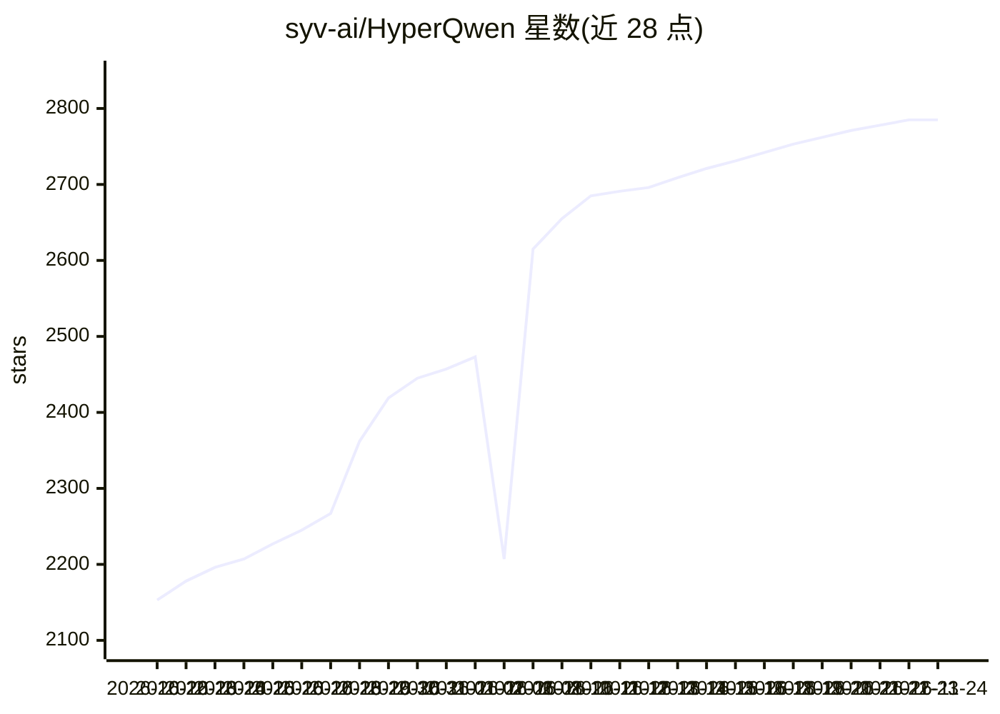

# syv-ai/HyperQwen

⭐ 2,790 · Python · Apache-2.0 · 推送 2026-11-10 · [GitHub](https://github.com/syv-ai/HyperQwen) · 组织维护

**让个人消费级 GPU 上快速部署大 Qwen 模型的 vLLM 补丁与量化工具集**

提供针对固定版本 vLLM 的补丁系列与模型准备流水线，在单张 24 GB 消费级显卡上以 Docker 镜像形式部署 Qwen3.8-27B，提供单用户与批量两种 compose profile，输出 OpenAI 兼容 API 并支持 key 认证。机制包括从 prompt 生成草稿的投机解码、int8 KV 缓存、KVarN 长上下文后端与 requant 头部处理。限制：目前仅在 RTX 3090/3080（sm86）上完整测量，其他架构缺少数据点，多卡仅支持 TP=2/TP=4。

## 筛选速览

| 维度 | 判定 | 备注 |
|---|---|---|
| AI 角色 | `ai-ecosystem` | LLM/agent 周边工具 |
| 许可风险 | `permissive` | Apache-2.0 |
| 部署形态 | `self-host` | docker 或自建部署 |
| 模型依赖 | local-ok | 支持本地模型 |
| 硬件要求 | — | 无带数字的原话,不猜 |
| 安装摩擦 | `low` | 无编译、无系统依赖或容器化 |
| 成熟度 | — | 结构信号不足 |

## 能力要点

- 单张 24 GB 卡运行 Qwen3.8-27B，支持 150k-240k 上下文配置
- 单用户与批量两种 docker compose profile，OpenAI 兼容 API
- 从 prompt 生成草稿的投机解码与 requant 模型准备流水线
- 内置基准测试 harness，接受社区提交的跨显卡测试报告

## 适用场景

- 用自有 RTX 3090 级显卡搭建本地 Qwen 推理服务
- 为多人并发场景提供本地 API 后端
- 在自己的显卡上复现并提交推理基准数据

## 场景标签

`推理引擎` `模型量化` · 领域:训练与推理

## 证据(README 行号)

> L25: really is, under the serving setup, is a patch series against a pinned vLLM plus
> L19: consumer GPU with vLLM — 150k token context and an OpenAI-compatible API with key

## 星数曲线

2026-10-22 2,153 → 2026-11-24 2,785（+632）

---
*卡片 v1 · prompt 1.4 · 生成 2026-11-23 · 置信度 high · 依据 README sha `6430a4580545` · [字段定义](../../DATASET.md)*
