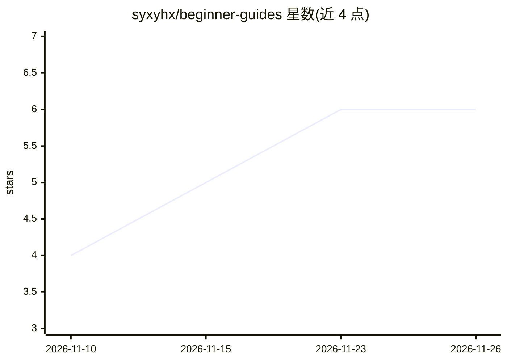

# syxyhx/beginner-guides

⭐ 6 · MIT · 推送 2026-11-11 · [GitHub](https://github.com/syxyhx/beginner-guides) · 个人维护 · 中文 README

**面向学生的三份入门实操教程：GitHub、云服务器、API 密钥**

以 PDF 与分册 README 两种形态提供的三份教程：GitHub 新手使用（注册、学生认证、客户端、推送协作）、云服务器选购搭建与 dsh 接入（配置、初始化、部署、手机访问）、阿里云百炼学生券与 API 密钥获取（领券、密钥、填入客户端、控制预算）。面向无基础学生，配套阅读路径表、占位符与密钥安全约定、勘误反馈流程，声明与厂商无隶属关系。

## 筛选速览

| 维度 | 判定 | 备注 |
|---|---|---|
| AI 角色 | `ai-knowledge` | 知识聚合/清单类 |
| 许可风险 | `permissive` | MIT |
| 部署形态 | `None` |  |
| 模型依赖 | — | README 未给出锁定关系 |
| 硬件要求 | — | 无带数字的原话,不猜 |
| 安装摩擦 | `low` | 无编译、无系统依赖或容器化 |
| 成熟度 | — | 结构信号不足 |

## 能力要点

- 三份教程分别覆盖代码托管、云服务器搭建、大模型 API 接入
- PDF 与分册 README 双形态，带目录页码与勘误记录
- 按读者处境给出阅读路径对照表
- 内置占位符、提交身份、密钥安全等阅读约定

## 适用场景

- 第一次把课程作业从压缩包改用 GitHub 提交
- 想租一台服务器让程序 7×24 小时在线
- 想用学生券免费拿到大模型 API Key 试试调用

## 场景标签

`教程课程` · 领域:学习与行业

## 证据(README 行号)

> L5: 三份教程，三件绕不开的事——**把代码托管起来**、**有一台自己的服务器**、**拿到能调用的模型 API**。都是排版定型的 PDF，按顺序照做即可，不需要看完全部。
> L18: |03|**阿里云百炼学生券与 API 密钥获取教程**|13|怎么免费调用大模型|领 300 元学生券、拿到 API 密钥和接口地址、填进任意客户端、控制不超支|

## 星数曲线

2026-11-10 4 → 2026-11-26 6（+2）

---
*卡片 v1 · prompt 1.4 · 生成 2026-11-21 · 置信度 high · 依据 README sha `94c7223843f9` · [字段定义](../../DATASET.md)*
