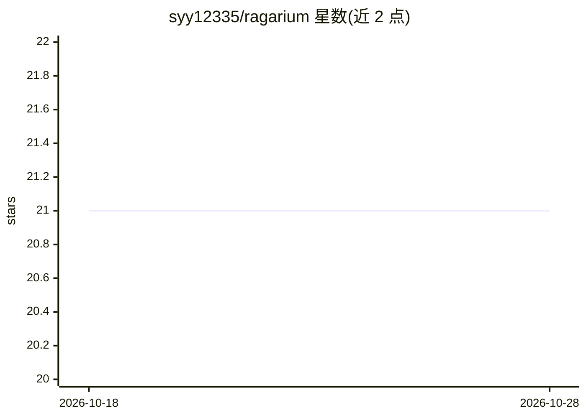

# syy12335/ragarium

⭐ 21 · Python · MIT · 推送 2026-06-13 · [GitHub](https://github.com/syy12335/ragarium) · 个人维护 · 中文 README

**本地优先的中文 RAG 工作台：编排、评测与部署为本地 API**

面向中文用户的本地单机 RAG 工作台：导入 txt/md/html/pdf/docx 与单页 URL，切分后写入本地 Chroma 向量库；用可视化画布编排 RAG Graph（React Flow），可从模板或空白开始。基于知识库与 3-5 个示例 Query 自动生成 query-only 评测集，默认运行 reference-free 的 RAGAS 指标（faithfulness、answer_relevancy）。编排好的 Graph 可一键暴露为本地 FastAPI Runtime API，供外部通过 HTTP/JSON invoke/batch 调用。默认模型服务商为千问，需配置 API Key；第一版为单用户本地产品，无登录与多租户。

## 筛选速览

| 维度 | 判定 | 备注 |
|---|---|---|
| AI 角色 | `ai-ecosystem` | LLM/agent 周边工具 |
| 许可风险 | `permissive` | MIT |
| 部署形态 | `library` | 以包/库形式分发 |
| 模型依赖 | — | README 未给出锁定关系 |
| 硬件要求 | — | 无带数字的原话,不猜 |
| 安装摩擦 | `low` | 无编译、无系统依赖或容器化 |
| 成熟度 | `idea` | |

## 能力要点

- 可视化画布编排 RAG Workflow 并保存 Graph
- 自动生成 query-only 评测集并运行 RAGAS reference-free 指标
- Workflow 一键暴露为本地 HTTP Runtime API（invoke/batch）
- 本地 Chroma 向量库 + SQLite 状态库，数据全部落本地

## 适用场景

- 把自有资料构建成本地知识库并编排 RAG 问答流程
- 自动生成评测集并跑 RAGAS 指标检验 RAG 效果
- 把编排好的 RAG Graph 以本地 HTTP API 供其他程序调用

## 场景标签

 · 领域:LLM 基础设施/RAG

## 证据(README 行号)

> L9: - 直接运行 RAGAS 评测并查看每条样本的回答、上下文和指标。
> L10: - 将准备好的 Workflow 暴露成本地 HTTP Runtime API，供外部程序通过 `invoke` 或 `batch` 调用。
> L27: - 对外提供 Runtime API：其他语言可以通过 HTTP/JSON 调用某个 RAG Graph 的输入输出。

## 星数曲线

2026-10-18 21 → 2026-10-28 21（+0）

---
*卡片 v1 · prompt 1.4 · 生成 2026-10-28 · 置信度 high · 依据 README sha `0fd16e3c0b2f` · [字段定义](../../DATASET.md)*
