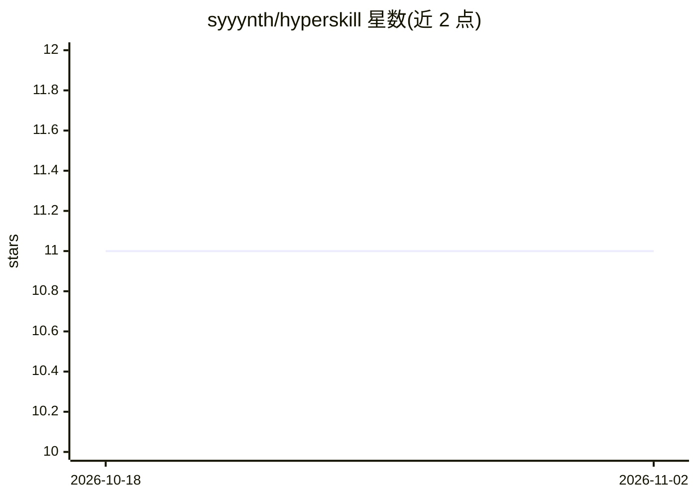

# syyynth/hyperskill

⭐ 11 · Python · Apache-2.0 · 推送 2026-02-11 · [GitHub](https://github.com/syyynth/hyperskill) · 个人维护

**个人维护的 Hyperskill 教育平台项目题解集合**

Hyperskill（JetBrains 旗下教育平台）Python 项目解题代码的个人仓库：按 Easy/Medium/Hard/Nightmare 难度收录 137 个项目条目（完成 57、进行中 80），每个条目附项目官网链接，解法多含最终阶段代码与测试文件；另有无题解的 Math/ML、Git 与 SQL 分类。README 声明该清单用途为待办清单并提示勿抄袭，标注 AI 项目依赖 OpenAI 付费订阅。运行方式为创建 venv、pip 安装依赖后启动对应 app.py。

## 筛选速览

| 维度 | 判定 | 备注 |
|---|---|---|
| AI 角色 | `ai-knowledge` | 知识聚合/清单类 |
| 许可风险 | `permissive` | Apache-2.0 |
| 部署形态 | `desktop` | 安装包/桌面程序 |
| 模型依赖 | — | README 未给出锁定关系 |
| 硬件要求 | — | 无带数字的原话,不猜 |
| 安装摩擦 | `low` | 无编译、无系统依赖或容器化 |
| 成熟度 | — | 结构信号不足 |

## 能力要点

- 137 个 Hyperskill Python 项目条目，按四档难度组织
- 各条目附 hyperskill.org 项目链接与完成状态标记
- 另含 Math/ML、Git、SQL 分类（后者含各阶段题解）
- README 明确标注为个人待办清单并声明无严格风格规范

## 适用场景

- 对照 Hyperskill 学习项目查找他人解题参考
- 按难度浏览 Hyperskill Python 项目清单做学习规划
- 了解各项目（含 AI/RAG/Agent 类）的完成状态

## 场景标签

`精选清单` · 领域:学习与行业

## 证据(README 行号)

> L1: This list serves merely as a _to-do_ list, and you're welcome to use it as such. Avoid cheating or copying solutions
> L4: 🐍 Total: 137, 👷🏼‍♂️ In process: 80, 🐱‍👤 Done: 57

## 星数曲线

2026-10-18 11 → 2026-11-02 11（+0）

---
*卡片 v1 · prompt 1.4 · 生成 2026-11-01 · 置信度 mid · 依据 README sha `0ff9b581333f` · [字段定义](../../DATASET.md)*
