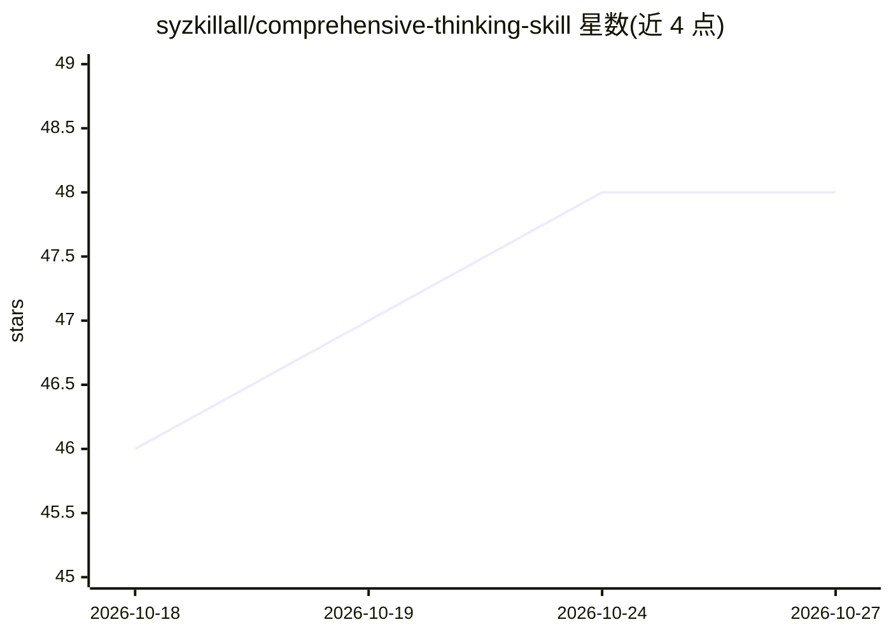

# syzkillall/comprehensive-thinking-skill

⭐ 48 · Apache-2.0 · 推送 2026-06-06 · [GitHub](https://github.com/syzkillall/comprehensive-thinking-skill) · 个人维护 · 中文 README

**为 AI agent 设计的推理思维模式 skill，提升复杂判断质量**

一个面向 AI agent 的思维模式技能：在 AI 面对高复杂度、高不确定性问题时，通过引导其思维过程（前提审计、反方论证压力、批判性思维、黑格尔辩证法、元认知审视）来产出更可靠、可验证的结论。作者指出其定位区别于做 PPT、找 Bug 等执行型 skill，关注的是推理质量本身。建议在 Codex 环境下使用（作者的设计环境），README 未给出安装命令或文件格式细节。适用场景包括寻医问药咨询、专业研究与精密系统设计等对推理严肃性要求高的提问。

## 筛选速览

| 维度 | 判定 | 备注 |
|---|---|---|
| AI 角色 | `ai-ecosystem` | LLM/agent 周边工具 |
| 许可风险 | `permissive` | Apache-2.0 |
| 部署形态 | `None` |  |
| 模型依赖 | — | README 未给出锁定关系 |
| 硬件要求 | — | 无带数字的原话,不猜 |
| 安装摩擦 | `low` | 无编译、无系统依赖或容器化 |
| 成熟度 | — | 结构信号不足 |

## 能力要点

- 结合批判性思维、黑格尔辩证法与元认知审视的推理引导框架
- 针对复杂/不确定问题的前提审计与反方论证压力机制
- 以对话触发词形式调用（如"请用全面思考..."）

## 适用场景

- 让 AI 在复杂决策问题上给出经过推敲的结论
- 对专业领域问题要求更严肃的推理过程
- 提升 AI 回答的可信度以辅助研究或方案设计

## 场景标签

`提示工程` · 领域:Agent 开发

## 证据(README 行号)

> L2: 全面思考是一套为 AI 设计的、旨在提升 AI 在面对高复杂度、不确定性问题时输出解决方案的质量与可靠性的思维模式。
> L22: 全面思考是一种为AI设计的思维模式，是我对 AI 可能性的一种探索。当我们在设计 skill 时，往往将 AI 视作一种执行工具，通过skill 来让 AI 帮助我们完成某种具体的任务，例如做 PPT、找 Bug 等，而高质量行为
> L24: #### 建议在codex上使用，这是我的设计环境。

## 星数曲线

2026-10-18 46 → 2026-10-27 48（+2）

---
*卡片 v1 · prompt 1.4 · 生成 2026-10-25 · 置信度 high · 依据 README sha `1ab34e0470a4` · [字段定义](../../DATASET.md)*
