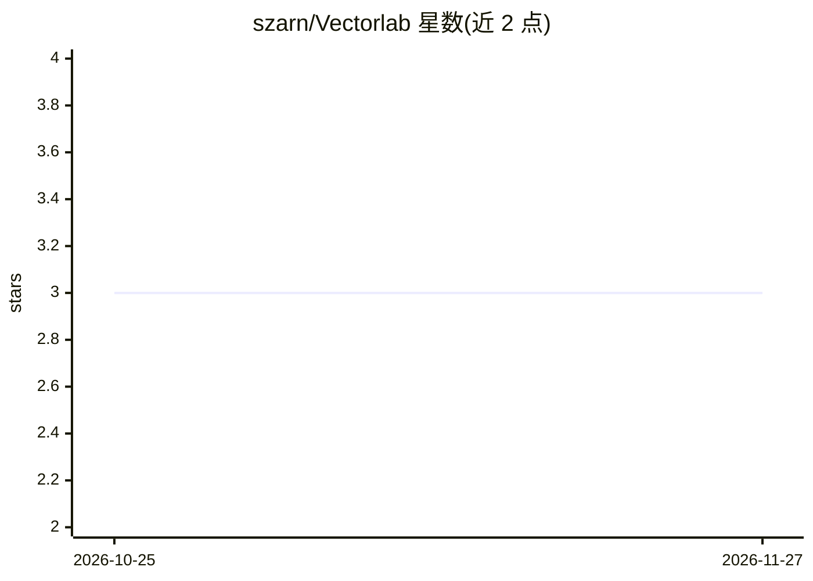

# szarn/Vectorlab

⭐ 3 · Python · Apache-2.0 · 推送 2026-10-20 · [GitHub](https://github.com/szarn/Vectorlab) · 个人维护

**面向科研人员抽取与编辑 transformer 语言模型行为方向的工具**

从两份对照数据集定义一个行为，在每一层抽取该行为的方向，生成离线 HTML 报告展示其表征位置，通过 Optuna 双目标搜索在 KL 散度预算内寻找最优编辑，编辑以可逆 hooks 应用或写入权重，导出为 safetensors 或 MLX。从零实现，针对 Apple Silicon（PyTorch MPS, bf16）编写，实测仅在 MPS 上验证过，支持 Qwen3、Llama 与 Gemma 3。用于研究语言模型内部行为表征及编辑效果。

## 筛选速览

| 维度 | 判定 | 备注 |
|---|---|---|
| AI 角色 | `ai-ecosystem` | LLM/agent 周边工具 |
| 许可风险 | `permissive` | Apache-2.0 |
| 部署形态 | `library` | 以包/库形式分发 |
| 模型依赖 | — | README 未给出锁定关系 |
| 硬件要求 | — | 无带数字的原话,不猜 |
| 安装摩擦 | `medium` | 含编译或系统依赖之一 |
| 成熟度 | — | 结构信号不足 |

## 能力要点

- 逐层抽取行为方向并输出含 Cohen's d、probe 准确率、logit lens 的 HTML 报告
- Optuna 双目标搜索（行为分数与 KL）定位源层、强度与层范围
- 编辑支持可逆 hooks 或权重正交化/烘焙偏置，可导出 safetensors 与 MLX
- 提取、分析、搜索、编辑、评测、导出、对比七个 CLI 子命令

## 适用场景

- 研究模型中拒绝/讨好/冗长等行为的表征位置
- 生成并评测受控的行为编辑模型
- 对比多个行为方向的相似性与交叉影响

## 场景标签

`科研工具` · 领域:学习与行业

## 证据(README 行号)

> L4: Vectorlab takes a behavior defined by two contrasting datasets, such as harmful vs harmless prompts or
> L126: Vectorlab is for research on how behaviors are represented inside language models, and on what editing

## 星数曲线

2026-10-25 3 → 2026-11-27 3（+0）

---
*卡片 v1 · prompt 1.4 · 生成 2026-11-21 · 置信度 high · 依据 README sha `d3f4bf0ddfc2` · [字段定义](../../DATASET.md)*
