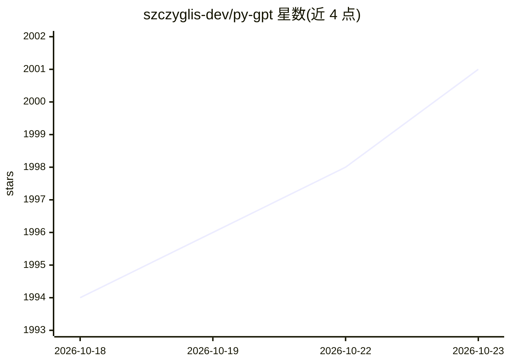

# szczyglis-dev/py-gpt

⭐ 2,001 · Python · NOASSERTION · 推送 2026-10-06 · [GitHub](https://github.com/szczyglis-dev/py-gpt) · [官网](https://pygpt.net) · 个人维护

**跨平台桌面 AI 助手：聚合多厂商模型，聊天/Agent/RAG/语音一体**

PyGPT 是面向 Linux/Windows/macOS 的开源桌面 AI 助手，以 Python 编写，提供类 ChatGPT 的本地对话界面。它接入 OpenAI、Google Gemini、Anthropic Claude、xAI Grok、Perplexity、DeepSeek 等云端模型，也支持 Ollama 本地模型与 OpenAI 兼容 API。功能包括 Agents（Chat/Orchestrator/Swarm 工作流）、插件与 MCP 连接器、LlamaIndex RAG、视觉与摄像头输入、图像/视频生成、语音输入输出、记忆与自动化等。云端模型使用用户自有 API key，本地 Ollama 模型无需外部密钥。提供 MSI/AppImage/Snap/PyPI/源码多种安装途径。

## 筛选速览

| 维度 | 判定 | 备注 |
|---|---|---|
| AI 角色 | `ai-native` | 本体是模型或模型工具 |
| 许可风险 | `none` | NOASSERTION |
| 部署形态 | `desktop` | 安装包/桌面程序 |
| 模型依赖 | local-ok | 支持本地模型 |
| 硬件要求 | — | 无带数字的原话,不猜 |
| 安装摩擦 | `medium` | 含编译或系统依赖之一 |
| 成熟度 | — | 结构信号不足 |

## 能力要点

- 接入 OpenAI/Gemini/Claude/Grok/Perplexity/DeepSeek 及 Ollama 本地模型
- Agents 多智能体工作流（Chat、Orchestrator、Swarm）与 SKILL.md 技能
- LlamaIndex RAG 与内置向量存储，支持 txt/pdf/docx 等多种格式
- 插件系统、MCP 连接器管理器、语音合成/识别与桌面控制

## 适用场景

- 在桌面端用统一的界面使用各家云端与本地模型
- 用 Agents 工作流和自定义工具执行自动化任务
- 基于自有文档和网页构建 RAG 问答
- 通过语音输入输出与视觉模型进行交互

## 场景标签

`AI 助手` `聊天机器人` · 领域:对话与助手

## 证据(README 行号)

> L17: **PyGPT** is an open-source desktop AI assistant for `Linux`, `Windows` and `macOS`. It supports models from `OpenA
> L19: Beyond chat, PyGPT includes Agents with Chat, Orchestrator and Swarm workflows, Agent Skills, plugins and MCP conne
> L40: - Runs as a local desktop application with a ChatGPT-like conversational interface.

## 星数曲线

2026-10-18 1,994 → 2026-10-23 2,001（+7）

---
*卡片 v1 · prompt 1.4 · 生成 2026-10-21 · 置信度 high · 依据 README sha `009ea917eb40` · [字段定义](../../DATASET.md)*
