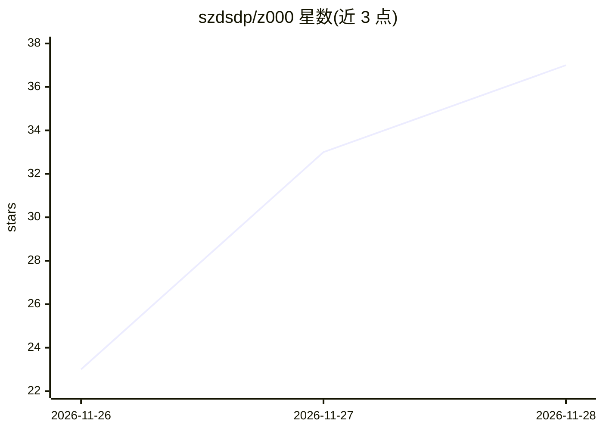

# szdsdp/z000

⭐ 37 · Java · 推送 2026-11-25 · [GitHub](https://github.com/szdsdp/z000) · [官网](https://www.szdsoft.cn) · 组织维护 · 中文 README

**给企业的低代码AI平台：拖拽搭建费控、报销、财务共享等应用**

基于 SpringCloud 微服务的企业数字化平台，提供低代码/零代码可视化配置，内置主数据、权限、工作流、BPM、电子影像、凭证管理、打印模板等基础组件。通过 Spring AI 框架接入 AI 能力，覆盖知识问答、数据采集、智能审批、数据分析等场景。深度集成 SAP（单据穿透、对接、数据同步），并可对接 OA、飞书、微信、钉钉、企微。平台需先部署后运行配套模板项目，部署包从官网下载，另有在线演示环境。

## 筛选速览

| 维度 | 判定 | 备注 |
|---|---|---|
| AI 角色 | `ai-enhanced` | 去掉 AI 部分产品仍成立 |
| 许可风险 | `none` | — |
| 部署形态 | `None` |  |
| 模型依赖 | — | README 未给出锁定关系 |
| 硬件要求 | — | 无带数字的原话,不猜 |
| 安装摩擦 | `low` | 无编译、无系统依赖或容器化 |
| 成熟度 | — | 结构信号不足 |

## 能力要点

- 零代码可视化拖拽配置，低代码提供 Jar 包、组件库、模板项目
- 结合 Spring AI 框架接入 AI 数据采集、智能审批、数据分析
- 免费提供百套 SAP 集成功能，支持与飞书/微信/钉钉等打通
- 内置主数据、工作流、BPM、电子影像、凭证管理等基础组件

## 适用场景

- 快速搭建费控、报销、财务共享、电子档案、SRM 等企业应用
- 私有化部署企业数字化平台并集成 SAP
- 在表单、工作流、影像识别业务链路中使用 AI 能力

## 场景标签

`数据分析` `工作流自动化` · 领域:效率与自动化

## 证据(README 行号)

> L7: 尚智得企业数字化AI平台采用 SpringCloud 微服务架构，融合低代码、零代码能力，支持可视化拖拽配置，快速搭建费控、报销、财务共享、电子档案、SRM等各类企业应用。 平台结合Spring AI框架，全域接入AI能力，覆盖 A
> L11: - ✅ 零代码可视化设计，低代码提供 Jar 包、组件库、模板项目，开包即用

## 星数曲线

2026-11-26 23 → 2026-11-28 37（+14）

---
*卡片 v1 · prompt 1.4 · 生成 2026-11-26 · 置信度 mid · 依据 README sha `0515ea5e7576` · [字段定义](../../DATASET.md)*
