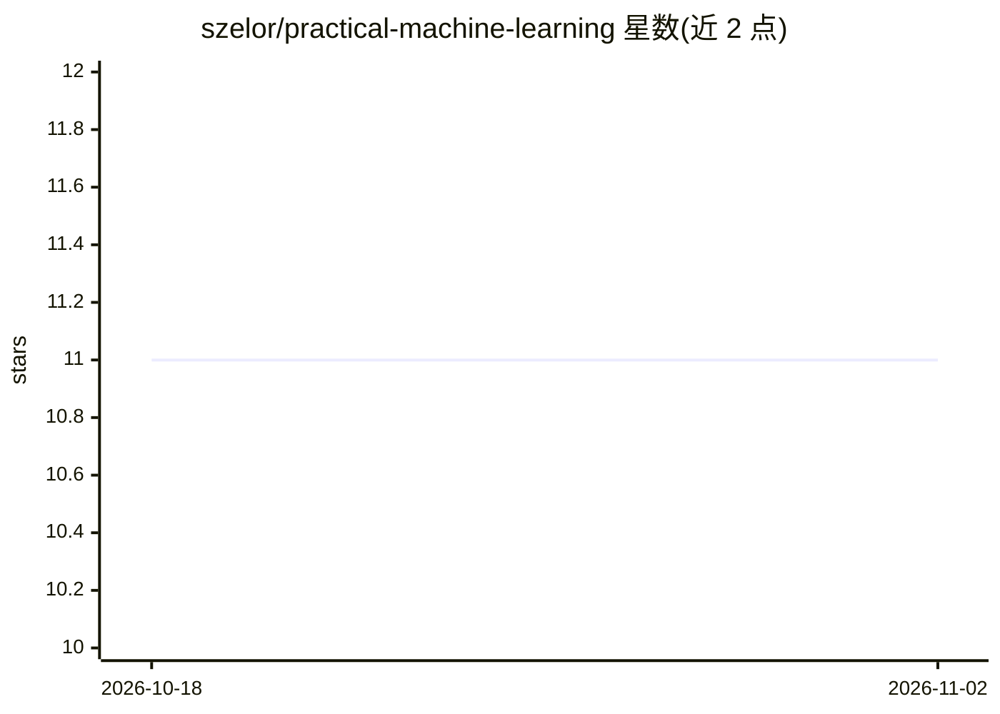

# szelor/practical-machine-learning

⭐ 11 · R · 推送 2026-02-23 · [GitHub](https://github.com/szelor/practical-machine-learning) · 个人维护

**波兰语机器学习书籍的配套数据与示例代码仓库**

存储《Praktyczne uczenie maszynowe》（波兰语机器学习教材）的配套数据集和示例代码。主题标签显示内容涉及 Python、R、SQL 与 SQL Server ML Services。读者可通过 README 提供的两个链接购买书籍（波兰语版）并从出版社网站获取配套数据库副本。README 信息有限，未展示具体安装或运行说明。

## 筛选速览

| 维度 | 判定 | 备注 |
|---|---|---|
| AI 角色 | `ai-knowledge` | 知识聚合/清单类 |
| 许可风险 | `none` | — |
| 部署形态 | `None` |  |
| 模型依赖 | — | README 未给出锁定关系 |
| 硬件要求 | — | 无带数字的原话,不猜 |
| 安装摩擦 | `low` | 无编译、无系统依赖或容器化 |
| 成熟度 | — | 结构信号不足 |

## 能力要点

- 提供书籍配套的数据与示例代码
- 覆盖 Python、R、SQL、SQL Server ML Services
- 可通过出版社链接获取配套数据库副本

## 适用场景

- 按书学习时获取配套数据与示例
- 获取书中示例所用的数据库副本

## 场景标签

`教程课程` · 领域:学习与行业

## 证据(README 行号)

> L2: Data and examples that support the material in the book "Praktyczne uczenie maszynowe".

## 星数曲线

2026-10-18 11 → 2026-11-02 11（+0）

---
*卡片 v1 · prompt 1.4 · 生成 2026-11-01 · 置信度 mid · 依据 README sha `2a2767f15752` · [字段定义](../../DATASET.md)*
