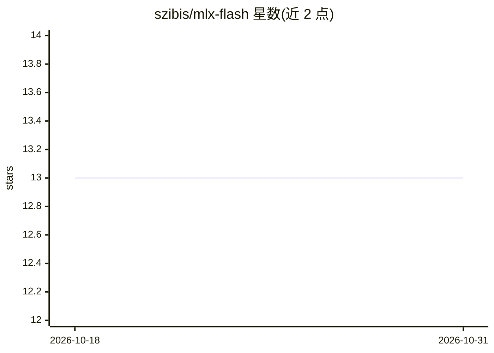

# szibis/mlx-flash

⭐ 13 · Python · MIT · 推送 2026-10-29 · [GitHub](https://github.com/szibis/mlx-flash) · [官网](https://github.com/szibis/MLX-Flash-compress) · 个人维护 · 中文 README

**让 Apple Silicon Mac 运行超出内存大小的 AI 模型的推理运行时**

基于 MLX 的本地推理服务器：实时读取 macOS 内核内存压力（vm_statistics64），将模型热数据保留在 RAM、冷数据从 SSD 按需流式读取，从而在有限内存的 Mac 上运行超出 RAM 容量的模型（如 32GB 跑 70B）。提供 MoE 专家缓存、三种投机解码策略、KV 压缩、Rust 代理多 worker 会话亲和、OpenAI/Ollama/MCP 三种 API、Prometheus 指标与 Web 控制台；另含可选的图像理解与图像编辑工具。仅限 Apple Silicon macOS 上做 GPU 推理，Docker 镜像仅用于测试。

## 筛选速览

| 维度 | 判定 | 备注 |
|---|---|---|
| AI 角色 | `ai-ecosystem` | LLM/agent 周边工具 |
| 许可风险 | `permissive` | MIT |
| 部署形态 | `self-host` | docker 或自建部署 |
| 模型依赖 | local-ok | 支持本地模型 |
| 硬件要求 | — | 无带数字的原话,不猜 |
| 安装摩擦 | `low` | 无编译、无系统依赖或容器化 |
| 成熟度 | `idea` | |

## 能力要点

- SSD 流式 + 内存压力感知缓存，运行超出 RAM 的模型
- Rust 代理多 worker 会话亲和路由，KV cache 保持温热
- OpenAI / Ollama / MCP 三种 API 兼容
- 可选图像理解（mlx-vlm）与 FLUX.2 Klein 图像编辑工具

## 适用场景

- 小内存 Mac 上本地运行 30B-200B 级 MoE 模型
- 多人共享一台 Mac Studio 各自保持独立推理会话
- 通过 OpenAI 兼容 API 接入 LM Studio、Cursor、Claude Code 等客户端

## 场景标签

`推理引擎` `多模态` · 领域:感知与多模态

## 证据(README 行号)

> L105: mlx-flash --port 8080
> L190: |MCP + OpenAI + Ollama APIs|All three|OpenAI only|Ollama only|None|
> L209: MLX-Flash works with any MLX-compatible model. It especially shines with large MoE (Mixture of Experts) models whe

## 星数曲线

2026-10-18 13 → 2026-10-31 13（+0）

---
*卡片 v1 · prompt 1.4 · 生成 2026-10-31 · 置信度 high · 依据 README sha `0694b08c8d82` · [字段定义](../../DATASET.md)*
