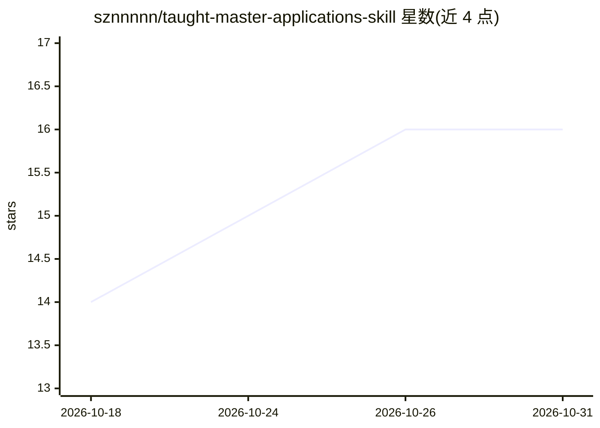

# sznnnnn/taught-master-applications-skill

⭐ 16 · HTML · 推送 2026-06-03 · [GitHub](https://github.com/sznnnnn/taught-master-applications-skill) · 个人维护 · 中文 README

**留学申请工作流 Agent Skill：选校分流、证据地图、文书与时间线**

一个安装到 AI Agent skills 目录的留学申请工作流 Skill（SKILL.md 格式，示例路径 ~/.codex/skills）。面向准备留学申请的用户，当前最完整路线为授课型硕士申请，另支持本科、研究型硕士、PhD、offer 比较的轻量分流。产出申请画像、Evidence map、longlist/shortlist 项目表、SOP/PS/CV 策略、按 deadline 倒排时间线与 application pack；各模块联动，上游信息变化时提示下游材料刷新。本地优先（资料默认留本机，Notion 仅为可选导出），中英双语输出，信息来源按官网已核查/二级来源/待官网确认分层。README 明确列出不适合事项：不保证录取、不编经历、不替代官网核查、不代为提交网申。

## 筛选速览

| 维度 | 判定 | 备注 |
|---|---|---|
| AI 角色 | `ai-ecosystem` | LLM/agent 周边工具 |
| 许可风险 | `none` | — |
| 部署形态 | `None` |  |
| 模型依赖 | — | README 未给出锁定关系 |
| 硬件要求 | — | 无带数字的原话,不猜 |
| 安装摩擦 | `low` | 无编译、无系统依赖或容器化 |
| 成熟度 | — | 结构信号不足 |

## 能力要点

- Route triage 分流：本科/授课硕/研究硕/PhD/offer 比较
- Evidence map 把课程、实习、research 转成申请证据并联动下游文书
- 本地 Markdown 资料表入口，缺口转为下一步任务而非连环追问
- 信息来源可信度分层（官网已核查/二级来源/待官网确认）

## 适用场景

- 我在准备授课型硕士申请，想要选校、文书和时间线一条线管理
- 我方向还不确定，先做路线分流和 Evidence map 定位
- 我已有几个 offer，想按费用、课程、职业路径做结构化比较

## 场景标签

`AI 写作` · 领域:内容生成

## 证据(README 行号)

> L293: taught-master-applications/
> L294: ├── SKILL.md
> L150: ### 方式二：手动安装到本地 skills 目录

## 星数曲线

2026-10-18 14 → 2026-10-31 16（+2）

---
*卡片 v1 · prompt 1.4 · 生成 2026-10-30 · 置信度 high · 依据 README sha `f60c1c48bb9d` · [字段定义](../../DATASET.md)*
