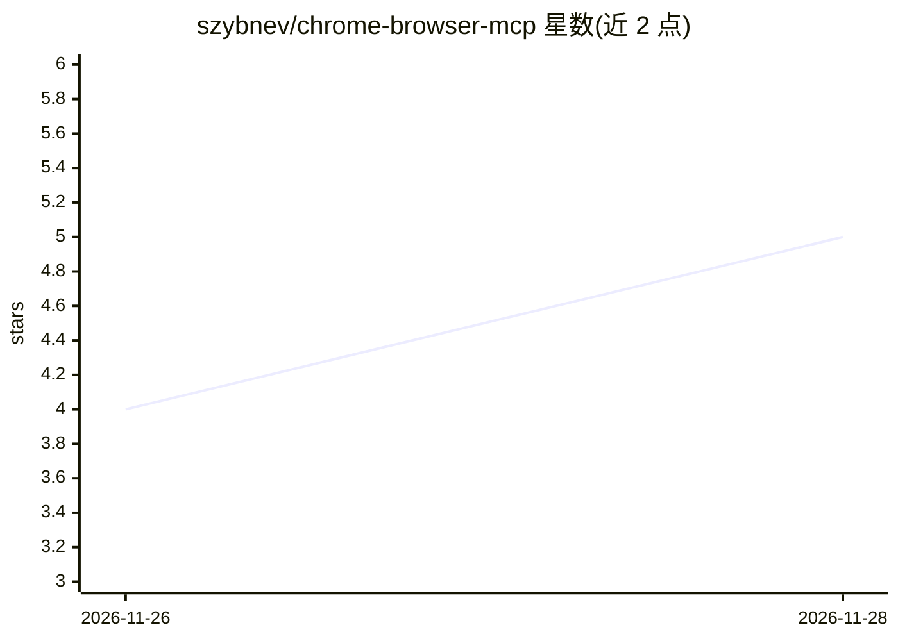

# szybnev/chrome-browser-mcp

⭐ 5 · HTML · MIT · 推送 2026-11-26 · [GitHub](https://github.com/szybnev/chrome-browser-mcp) · 个人维护 · 中文 README

**给 AI 客户端控制真实 Chrome 标签页的扩展与 MCP 服务器**

由 MV3 Chrome 扩展与本地 MCP v2 服务器组成：默认通过 Content Script 与 WebMCP 操作用户已登录的日常浏览器会话，需要时按需附加 chrome.debugger CDP 并空闲自动分离；以剪裁后的 a11y/DOM 快照、增量 diff 与批量 browser_act 降低 token 消耗；通过共享 Broker Daemon（127.0.0.1）支持多 agent 与多浏览器配置文件并行，提供 AI Agent 标签分组、域名黑名单、风险操作审批与 Prompt-Injection Shield。从源码构建，扩展可从 Chrome Web Store 安装。

## 筛选速览

| 维度 | 判定 | 备注 |
|---|---|---|
| AI 角色 | `ai-ecosystem` | LLM/agent 周边工具 |
| 许可风险 | `permissive` | MIT |
| 部署形态 | `library` | 以包/库形式分发 |
| 模型依赖 | — | README 未给出锁定关系 |
| 硬件要求 | — | 无带数字的原话,不猜 |
| 安装摩擦 | `low` | 无编译、无系统依赖或容器化 |
| 成熟度 | — | 结构信号不足 |

## 能力要点

- 真实登录会话控制：无需 --remote-debugging-port，工作于日常 Chrome/Arc/Brave/Edge 配置文件
- 混合执行引擎：Content Script + WebMCP 默认静默执行，按需 CDP 空闲自动分离
- a11y/DOM 剪裁快照、增量 diff 与批量 browser_act 以减少每步 token 占用
- 共享 Broker Daemon 多路复用多 agent/多配置文件，内置 Prompt-Injection Shield 与审批门控

## 适用场景

- 让 Antigravity/Claude Desktop 等 MCP 客户端操作我已登录的真实浏览器标签页
- 多 agent 同时使用浏览器而不产生端口冲突
- 在本地运行、不上传数据的浏览器自动化流程
- 用“Show by hand”录制器记录可回放的操作流程

## 场景标签

`浏览器自动化` · 领域:效率与自动化

## 证据(README 行号)

> L5: **Next-gen Chrome Extension (MV3) & MCP v2 Server for real-session AI browser use**
> L7: Hybrid Content Script + On-Demand CDP · Native WebMCP · Prompt-Injection Shield · Workflow Recorder · Multi-Profile 
> L107: Chrome Browser MCP provides native GUI integrations with unified **Browser Control Deck** UX across all major desk

## 星数曲线

2026-11-26 4 → 2026-11-28 5（+1）

---
*卡片 v1 · prompt 1.4 · 生成 2026-11-26 · 置信度 mid · 依据 README sha `d50fe31e3570` · [字段定义](../../DATASET.md)*
