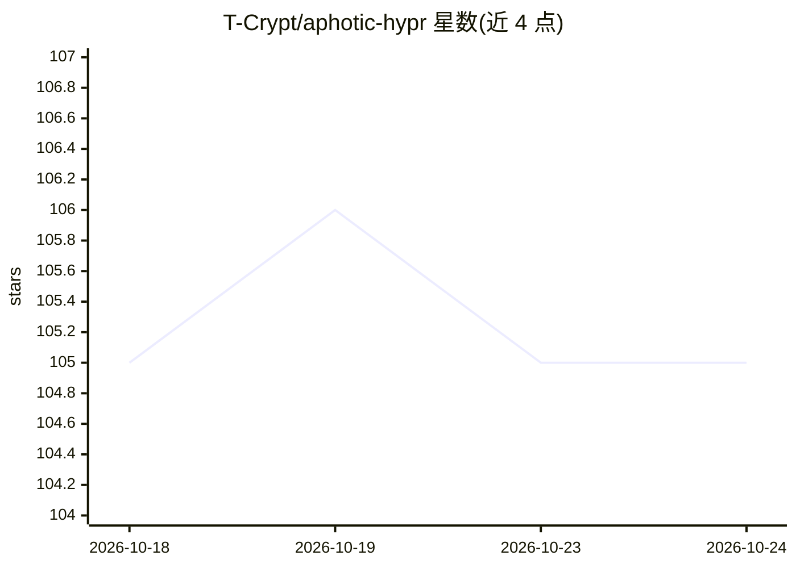

# T-Crypt/aphotic-hypr

⭐ 105 · QML · GPL-3.0 · 推送 2026-10-24 · [GitHub](https://github.com/T-Crypt/aphotic-hypr) · 个人维护

**基于 Quickshell 的模块化 Hyprland 桌面配置（dotfiles）**

面向 Arch/AUR 用户的 Hyprland 桌面环境配置集：以单一 Quickshell shell 提供栏、启动器、通知、锁屏、设置与 Command Center，支持八款主题实时切换或从壁纸生成，插件平台可在运行中的桌面安装/移除 AI 聊天、agent 跟踪、开发工具与桌面宠物等插件；Flow 资源图显示争夺 GPU 内存的工作负载并给出修复建议。提供 Developer/Gaming/AI/Security 可选分层配置，通过 git clone 与 install.sh 安装，状态标注为 Beta。

## 筛选速览

| 维度 | 判定 | 备注 |
|---|---|---|
| AI 角色 | `ai-enhanced` | 去掉 AI 部分产品仍成立 |
| 许可风险 | `viral` | GPL-3.0 |
| 部署形态 | `None` |  |
| 模型依赖 | — | README 未给出锁定关系 |
| 硬件要求 | — | 无带数字的原话,不猜 |
| 安装摩擦 | `low` | 无编译、无系统依赖或容器化 |
| 成熟度 | `idea` | |

## 能力要点

- 单一 Quickshell shell 覆盖栏/启动器/通知/锁屏/设置/Command Center
- 插件平台支持在运行中的桌面安装/移除 AI 聊天、agent 跟踪等插件
- 八款主题实时切换，可从任意壁纸生成主题
- Flow 资源图显示 GPU 内存争用并给出修复建议

## 适用场景

- Arch 用户搭建模块化 Hyprland 桌面环境
- 按 Developer/Gaming/AI/Security 分层选择配置
- 通过插件方式为桌面添加 AI 聊天与 agent 跟踪功能

## 场景标签

 · 领域:桌面环境/Linux 配置

## 证据(README 行号)

> L7:  A modular Hyprland desktop built on one Quickshell shell.
> L23: - **Plugins for everything extra.** AI chat, agent tracking, dev tools and

## 星数曲线

2026-10-18 105 → 2026-10-24 105（+0）

---
*卡片 v1 · prompt 1.4 · 生成 2026-10-23 · 置信度 high · 依据 README sha `871ed615863f` · [字段定义](../../DATASET.md)*
