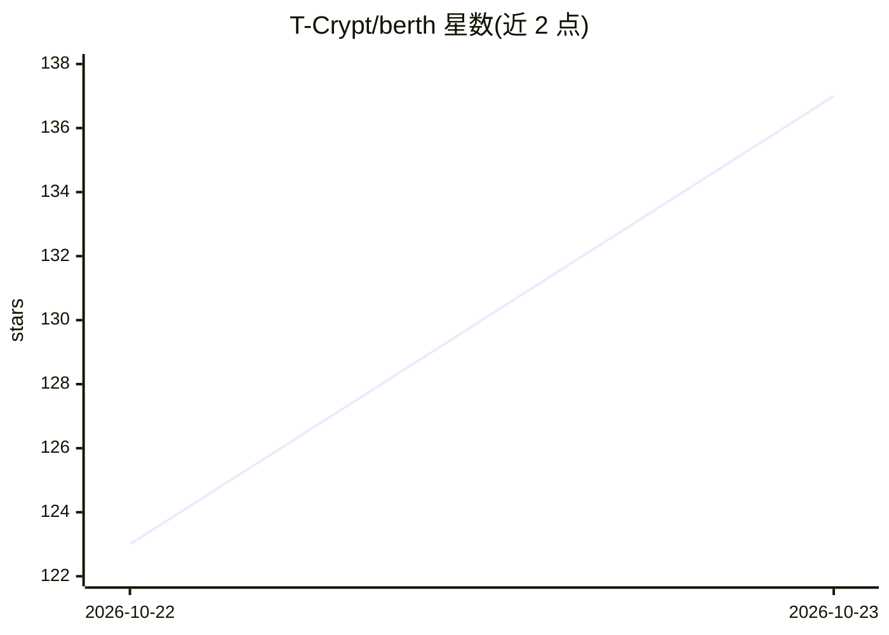

# T-Crypt/berth

⭐ 137 · Go · Apache-2.0 · 推送 2026-10-22 · [GitHub](https://github.com/T-Crypt/berth) · [官网](https://t-crypt.github.io/berth/) · 个人维护

**单卡 GPU 租约调度器：让本地推理引擎排队轮流用卡、避免 OOM 互撞**

Go 单二进制工具，在多类 GPU 程序之间做租约仲裁：聊天模型、ComfyUI、语音引擎、游戏、创意软件等通过 berth run 或网关申请占卡，berthd 按优先级排队，等持有者完成当前任务后卸载（可先移入 RAM），确认显存释放后再授予下一个。支持 Docker/Podman 内引擎、游戏自动让卡、Hugging Face/CivitAI 模型拉取与校验、Prometheus 指标与 web UI。自述 alpha（v0.3.4），Linux+NVIDIA 支持较完整，AMD 与 Windows 为实验性。

## 筛选速览

| 维度 | 判定 | 备注 |
|---|---|---|
| AI 角色 | `ai-ecosystem` | LLM/agent 周边工具 |
| 许可风险 | `permissive` | Apache-2.0 |
| 部署形态 | `desktop` | 安装包/桌面程序 |
| 模型依赖 | — | README 未给出锁定关系 |
| 硬件要求 | — | 无带数字的原话,不猜 |
| 安装摩擦 | `low` | 无编译、无系统依赖或容器化 |
| 成熟度 | `idea` | |

## 能力要点

- 按 hold/foreground/interactive/batch 优先级排队，等待者得到排队原因而非 OOM
- ComfyUI/vLLM/SGLang 支持移入 RAM 的 park 协议，加快切换
- berth gateway 提供单一 OpenAI 兼容端口并代理 ComfyUI 工作流
- 识别未持租约的 VRAM 占用进程（stowaway）并报告 PID 与内存

## 适用场景

- 单张 GPU 上同时跑本地聊天模型、ComfyUI 和游戏，互不 OOM 崩溃
- 游戏启动时自动让 AI 引擎让出显卡
- 盘点本机所有模型文件并从 Hugging Face/CivitAI 下载校验

## 场景标签

`推理引擎` · 领域:训练与推理

## 证据(README 行号)

> L16: Berth decides who gets your GPU. Chat models, image pipelines, voice engines, games and GPU apps
> L30: Every engine asks berthd for the card: through `berth run`, the gateway, ComfyUI's API or a game
> L99: - **`berth gateway`**: one OpenAI-compatible port. Name a model and Berth starts its engine,

## 星数曲线

2026-10-22 123 → 2026-10-23 137（+14）

---
*卡片 v1 · prompt 1.4 · 生成 2026-10-23 · 置信度 mid · 依据 README sha `451ec7f40eeb` · [字段定义](../../DATASET.md)*
